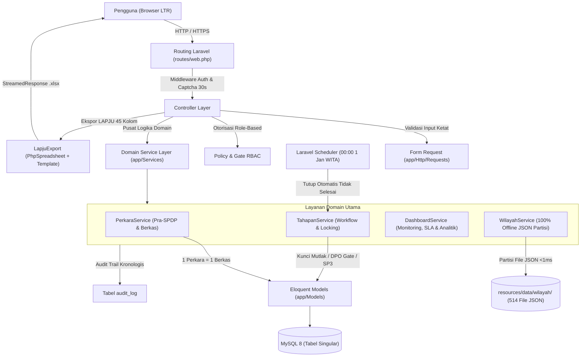
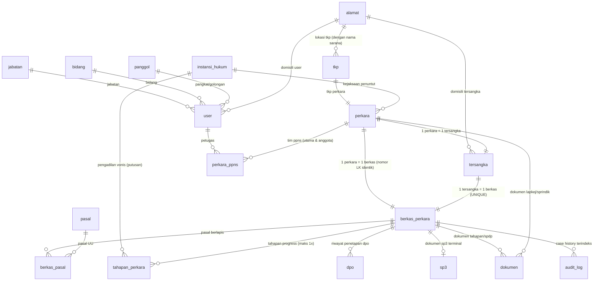
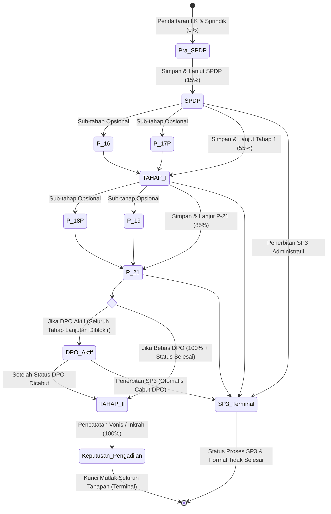
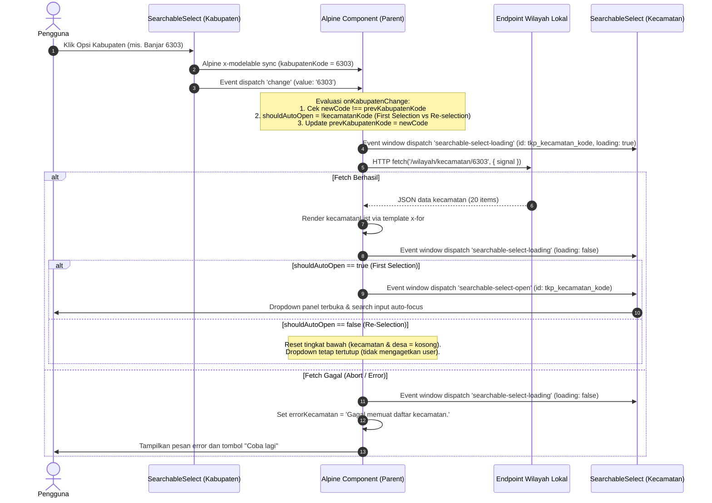

# ARCHITECTURE — BAPTwo

Arsitektur teknis BAPTwo. Aturan bisnis merujuk ke `PRD.md`; log keputusan teknis ke `DECISIONS.md`.

---

## 1. Gambaran Umum

- Monolit **Laravel 12** server-rendered (Blade + Alpine.js + Tailwind CSS v4) di atas template TailAdmin yang telah dirampingkan bersih (D-036, D-037).
- Satu database **MySQL 8** di lingkungan Laragon (D-001).
- Single locale **id** (Bahasa Indonesia) dan tata letak **LTR saja** (D-003, D-004).
- Bebas dari ketergantungan API pihak ketiga eksternal. Seluruh data wilayah administratif 38 provinsi, 514 kabupaten/kota, dan 83.762 desa beroperasi **100% offline lokal** berbasis partisi JSON berkecepatan tinggi (<1ms) (D-087, D-088).
- Ekspor resmi pelaporan rekap perkara format template resmi LAPJU Excel (.xlsx) 45 kolom terstandarisasi BPOM (D-035, D-055).



---

## 2. Lapisan & Tanggung Jawab

| Lapisan | Lokasi | Tanggung Jawab |
|---|---|---|
| **Controller** | `app/Http/Controllers` | Menerima HTTP request, memanggil Form Request / Policy / Service, mengembalikan response Blade/JSON/Redirect/Streamed Excel. Bersih dari logika bisnis. |
| **Form Request** | `app/Http/Requests` | Validasi tipe, format, digit (mis. NIK 16 digit), batasan berkas PDF (max 5 MB), dan kelengkapan field input pengguna. |
| **Policy & Gate** | `app/Policies` & `AppServiceProvider` | Otorisasi hak akses berbasis peran (Penyidik, Pimpinan, Administrator) termasuk gate `export-excel` dan pembatasan Master Data. |
| **Domain Service** | `app/Services` | Pusat seluruh aturan bisnis: transisi tahapan progress, kalkulasi bobot (0%, 15%, 55%, 85%, 100%), penguncian permanen, DPO gate, trigger formal, audit trail, serta kalkulasi analitik dashboard zona Makassar (D-056). |
| **Model** | `app/Models` | Definisi tabel singular (`protected $table = '...'`), query scopes (`dalamProses`, `selesai`, `tidakSelesai`, `tahunLk`), relasi Eloquent, accessor (`alamat_lengkap`), casting, dan soft deletes. |
| **Enum** | `app/Enums` | Representasi tipe aman PHP 8.2: `UserRole`, `JenisTahap`, `StatusProses`, `StatusFormal`. |
| **Export Engine** | `app/Exports` | Generator laporan Excel (.xlsx) resmi template LAPJU 45 kolom (A s.d. AS) berbasis PhpSpreadsheet IOFactory, freeze pane A7, nomor urut 1–45, dan penanganan periode kosong. |
| **View & Component** | `resources/views` | Template Blade modular TailAdmin, interaktivitas Alpine.js, icon resmi Flaticon (`fi fi-rr-*`), teks UI via `__()` dan `lang/id.json`. |

---

## 3. Model Data & Skema Database

Semua tabel domain wajib menggunakan nama **singular `snake_case` Bahasa Indonesia** (D-008, D-009) dan menyertakan kolom `created_by`, `updated_by`, serta `deleted_at` (`SoftDeletes`).

### 3.1 Relasi Entitas (ERD Mutakhir)



### 3.2 Spesifikasi Tabel Utama

1. **`alamat`** (D-009, D-015, D-039)
   - `id`: bigint unsigned, PK
   - `nama`: string(150), nullable (nama toko, kios, gudang, atau sarana usaha TKP)
   - `provinsi_kode`, `provinsi_nama`: string(15), string(100), nullable (Kalsel = 63)
   - `kabupaten_kode`, `kabupaten_nama`: string(15), string(100), nullable
   - `kecamatan_kode`, `kecamatan_nama`: string(15), string(100), nullable
   - `desa_kode`, `desa_nama`: string(15), string(100), nullable
   - `rt`, `rw`: string(5), nullable
   - `alamat_detail`: string(255), nullable
   - `created_at`, `updated_at`
   - *Accessor*: `alamat_lengkap` (format gabungan utuh jalan + RT/RW + Desa + Kec + Kab + Prov).

2. **`user`** (D-005, D-008)
   - `id`: bigint unsigned, PK
   - `role`: enum (`administrator`, `penyidik`, `umum`), default `penyidik` (D-071)
   - `jabatan_id`, `bidang_id`, `panggol_id`, `alamat_id`: FK nullable
   - `nama`: string(150), `nip`: string(30) nullable unique, `email`: string(255) unique
   - `password`: string(255)
   - `is_active`: boolean, default true
   - `created_by`, `updated_by`, `created_at`, `updated_at`, `deleted_at`

3. **`tkp`** (Tempat Kejadian Perkara — D-035 Poin 3)
   - `id`: bigint unsigned, PK
   - `alamat_id`: FK -> `alamat.id`
   - `klasifikasi`: enum (`retailer`, `distributor`)
   - `legalitas`: enum (`legal`, `ilegal`) — via radio button UI
   - `modus`: enum (`online`, `offline`) — via radio button UI
   - `created_by`, `updated_by`, `created_at`, `updated_at`, `deleted_at`

4. **`perkara`** (Informasi Pra-SPDP — D-035 Poin 5)
   - `id`: bigint unsigned, PK
   - `nomor_laporan_kejadian`: string(100), unique
   - `tanggal_laporan_kejadian`: date
   - `tahap_laporan_status`: enum (`draft`, `final`)
   - `nomor_surat_perintah`: string(100), unique nullable
   - `tanggal_surat_perintah`: date nullable
   - `tahap_sprindik_status`: enum (`draft`, `final`) nullable
   - `tahap_perkara_status`: enum (`draft`, `final`) nullable
   - `tkp_id`: FK -> `tkp.id` nullable
   - `penuntut_instansi_id`: FK -> `instansi_hukum.id` nullable (Kejaksaan)
   - `penuntut_nama`: string(150), nullable
   - `penuntut_nip`: string(30), nullable
   - `deskripsi`: text, nullable
   - `created_by`, `updated_by`, `created_at`, `updated_at`, `deleted_at`

5. **`tersangka`** (D-035 Poin 8, 17)
   - `id`: bigint unsigned, PK
   - `perkara_id`: FK -> `perkara.id`, ON DELETE CASCADE
   - `nama`: string(150), `alias`: string(150) nullable, `bin_binti`: string(150) nullable
   - `nik`: string(20) nullable (wajib tepat 16 digit pada finalisasi)
   - `tempat_lahir`, `tanggal_lahir`, `jenis_kelamin`, `agama`, `pekerjaan`, `kewarganegaraan` (default 'WNI')
   - `alamat_id`: FK -> `alamat.id` nullable
   - `created_by`, `updated_by`, `created_at`, `updated_at`, `deleted_at`

6. **`berkas_perkara`** (Tracking, SLA & Progress - D-035 Poin 5, 11, D-058)
   - `id`: bigint unsigned, PK
   - `perkara_id`: FK -> `perkara.id`, ON DELETE CASCADE
   - `tersangka_id`: FK -> `tersangka.id`, UNIQUE (1 tersangka = 1 berkas)
   - `nomor_berkas`: string(150) - **Wajib identik dengan nomor Laporan Kejadian**
   - `tanggal_spdp`: date, nullable (titik awal proses berkas perkara & tahun batas)
   - `status_formal`: enum (`selesai`, `tidak_selesai`), nullable (`null` = label "Dalam Proses")
   - `status_proses`: string(50), default 'Baru' (mengikuti tahapan final terakhir, atau 'SP3')
   - `progress_persen`: unsigned tinyint, default 0 (0, 15, 55, 85, 100)
   - `is_dpo`: boolean, default false
   - `sla_deadline`: date, nullable (1 bulan kalender per tahapan aktif atau batas 31 Desember)
   - `created_by`, `updated_by`, `created_at`, `updated_at`, `deleted_at`

7. **`dokumen`** (Sentralisasi File Wajib PDF — D-007, D-035 Poin 18)
   - `id`: bigint unsigned, PK
   - `perkara_id`, `berkas_perkara_id`, `tahapan_perkara_id`: FK nullable
   - `kategori`: enum (`lapkej`, `sprindik`, `spdp`, `tahapan`, `dpo`, `sp3`, `lainnya`)
   - `nama_dokumen`: string(150), `nama_file_asli`: string(255), `file_path`: string(500)
   - `file_size`: bigint unsigned (maksimum **5 MB** / 5.120 kB pada upload privat)
   - `created_by`, `updated_by`, `created_at`, `updated_at`, `deleted_at`
   - *Viewer Terpadu (D-047)*: Dilengkapi komponen global `<x-common.pdf-preview-modal />` dengan delegated click listener untuk pratinjau instan in-app tanpa meninggalkan konteks halaman.

8. **`sp3`** (Dokumen Penghentian Penyidikan — D-035 Poin 15, 22)
   - `id`: bigint unsigned, PK
   - `berkas_perkara_id`: FK -> `berkas_perkara.id`, UNIQUE
   - `nomor_surat`: string(150)
   - `tanggal`: date
   - `keterangan`: text (input manual uraian pertimbangan penghentian)
   - `dokumen_id`: FK -> `dokumen.id` (file PDF resmi)
   - `created_by`, `updated_by`, `created_at`, `updated_at`, `deleted_at`
   - *Status Terminal (SP3)*: Penerbitan SP3 langsung mengubah `status_proses = 'SP3'` dan `status_formal = 'tidak_selesai'`, serta mengunci berkas dan seluruh tahapan secara permanen di UI dan server (tidak dapat dicabut). Berbeda dengan status DPO yang dapat dicabut, SP3 menghentikan perkara secara mutlak.

---

## 4. Alur Tahapan & State Machine



### 4.1 Progress Berbobot Kumulatif
- **Pra-SPDP**: 0%
- **SPDP**: 15% (titik awal proses berkas perkara & perhitungan SLA 1 bulan kalender per tahap aktif)
- **TAHAP I**: 55% (+40%)
- **P-21 / P-21a**: 85% (+30%)
- **TAHAP II**: 100% (+15%) ➔ Pemicu otomatis status formal **Selesai**.
- **Keputusan Pengadilan**: Tetap 100% (pencatatan nomor & amar putusan pengadilan inkrah).
- *Sub-tahap opsional*: P-16, P-17P, P-18P, P-19 dicatat terintegrasi tanpa menambah persentase progress mandiri.

### 4.2 Tiga Aksi Setiap Tahap
1. **Batal**: Keluar halaman tanpa mengubah data.
2. **Draft**: Simpan formulir tanpa menaikkan progress, tanpa mengunci tahap.
3. **Simpan & Lanjut**: Wajib mengisi field pokok, mengunci tahap permanen (`locked_at`), menaikkan status proses dan persentase progress.

### 4.3 SOP Penanganan DPO & Validasi Pencabutan (D-079, D-080)
- **Pemblokiran Penuh**: Status DPO aktif memblokir seluruh tombol dan aksi penambahan tahapan berikutnya (SPDP, Tahap I, P-21, Tahap II, Putusan Pengadilan) di server dan antarmuka.
- **Pengecualian Khusus SP3**: Penerbitan SP3 tetap diizinkan saat DPO aktif. Penerbitan SP3 secara otomatis mencabut status DPO dan menghentikan perkara menjadi Tidak Selesai (ref: D-053).
- **Validasi Pencabutan Berkas Resmi**: Penonaktifan status DPO wajib mengisi form modal penyelesaian penangkapan/penahanan:
  - Jenis surat: `sp_kap` (Surat Perintah Penangkapan) atau `sp_han` (Surat Perintah Penahanan).
  - Nomor surat dan tanggal surat penindakan.
  - Unggah dokumen bukti penetapan fisik dalam format PDF (maksimal 5 MB).
  - Teks catatan/keterangan penangkapan.
- **Pencatatan Audit Trail**: Setiap aktivasi, perpanjangan, dan pencabutan DPO dicatat secara permanen di tabel `audit_log` dengan relasi `berkas_perkara_id` dan atribut dokumen terkait.

### 4.4 Kalkulasi SLA Bebas Overflow & Batas Mutlak 31 Desember (D-058, D-084)
- **Tenggat Waktu SLA**: 1 bulan kalender per tahapan aktif yang sedang berjalan (SPDP, Tahap I, P-21). Dihitung dari `tanggal_surat` tahapan aktif tersebut dan direset seketika saat tahapan berhasil difinalkan.
- **Algoritma Bebas Overflow (`addMonthNoOverflow()`)**: Menggantikan penambahan bulan standar Carbon (`addMonth()`) guna mencegah overflow tanggal 31 ke bulan kedua berikutnya. Contoh: tanggal surat 31 Januari menghasilkan tenggat 28/29 Februari (bukan 2 atau 3 Maret).
- **Batas Tahun Mutlak**: Berkas perkara dibatasi secara ketat hanya boleh berjalan pada tahun yang sama dengan tahun penerbitan SPDP. Jika kalkulasi SLA 1 bulan kalender jatuh pada tahun berikutnya, batas mutlak tanggal `31 Desember` tahun berjalan secara otomatis diprioritaskan (`deadline_keterangan` = "Batas Tahun Mutlak 31 Des").
- **Accessor Terstandarisasi**: Model `BerkasPerkara` menyediakan accessor `effective_deadline` dan `deadline_keterangan` untuk menjamin keselarasan tampilan sisa hari dan badge SLA di seluruh kartu dashboard, tabel daftar perkara, dan halaman detail perkara.

### 4.5 Banner Pemberitahuan Penutupan Berkas Tahunan di Dashboard (D-085)
- **Periode Aktif**: Ditampilkan secara otomatis pada `pages/dashboard/ecommerce.blade.php` khusus selama bulan Januari (`01 Januari s.d. 31 Januari`).
- **Otorisasi Terbatas**: Hanya dapat dilihat oleh pengguna dengan peran **Penyidik** dan **Administrator** yang menangani perkara (peran umum/pimpinan dibebaskan dari banner).
- **Evaluasi Berkas Sistem**: Muncul hanya jika terdapat berkas perkara tahun lalu yang ditutup otomatis oleh sistem (`aksi = 'sistem_tidak_selesai'`).
- **Penyimpanan Status Dismissal**: Pengguna dapat menyembunyikan banner melalui tombol tutup; status penutupan disimpan di `localStorage` per tahun penutupan (`baptwo_annual_closure_dismissed_{tahun}`).
- **Aksi Cepat**: Menyediakan tombol navigasi langsung ke Daftar Perkara dengan filter bawaan `status=tidak_selesai&tahun=:tahun_lalu`.

### 4.6 Inisiasi Form Tahapan & UX Pemilihan Berkas (D-063, D-097)
- **Modal Pemilihan Berkas**: Penambahan tahapan baru (SPDP s.d. Putusan Pengadilan) diinisiasi melalui modal pop-up inline `<x-tahapan.select-berkas-modal>` pada halaman index masing-masing tahapan.
- **Redireksi Aman Akses Langsung**: Endpoint URL pembuatan tahapan tanpa parameter berkas (`/spdp/create`, `/tahap-1/create`, `/p-21/create`, `/tahap-2/create`, `/putusan-perkara/create`) dialihkan (redirect 302) kembali ke halaman index tahapan terkait untuk mencegah inkonsistensi UX halaman standalone lama.
- **Rute Autentikasi Tunggal**: Autentikasi sistem hanya melayani rute resmi `/masuk` dan `/daftar`. Akses rute legacy template (`/signin`, `/signup`) dimatikan menghasilkan respon `404 Not Found`.

---

## 5. Hak Akses & Keamanan (RBAC)

| Modul / Aksi | Penyidik | Pimpinan | Administrator |
|---|:---:|:---:|:---:|
| Lihat Seluruh Perkara & Detail Berkas | ✅ | ✅ | ✅ |
| Tambah Laporan Kejadian & Sprindik | ✅ | ❌ | ✅ |
| Buat & Edit Draft Berkas Perkara | ✅ | ❌ | ✅ |
| Finalisasi Tahap (Simpan & Lanjut) | ✅ | ❌ | ❌ (Hanya Penyidik pemegang berkas) |
| Edit Tahap yang Sudah Final | ❌ (Terkunci Mutlak) | ❌ (Terkunci Mutlak) | ❌ (Terkunci Mutlak) |
| Aktivasi & Pencabutan DPO | ✅ | ❌ | ✅ |
| Terbitkan Dokumen SP3 | ✅ | ❌ | ✅ |
| Ekspor Excel LAPJU 45 Kolom (.xlsx) | ✅ | ❌ | ✅ |
| Akses Menu Progress Perkara | ❌ (Dialihkan ke Seluruh Perkara) | ✅ | ✅ |
| Master Data (Pasal & Instansi) | ✅ (Lihat Saja) | ❌ (403 Forbidden) | ✅ (Penuh) |
| Master Data (Jabatan, Bidang, Panggol) | ❌ (403 Forbidden) | ❌ (403 Forbidden) | ✅ (Penuh) |
| Manajemen Pengguna & Reset Password | ❌ | ❌ | ✅ |
| Soft Delete Perkara / Berkas | ✅ | ❌ | ✅ |
| Hard Delete (Penghapusan Fisik) | ❌ (Dilarang Mutlak) | ❌ (Dilarang Mutlak) | ❌ (Dilarang Mutlak) |

---

## 6. Fitur Pelaporan & Ekspor Excel Template LAPJU 45 Kolom (D-055)

- **Engine**: Menggunakan `PhpOffice\PhpSpreadsheet` via `App\Exports\LapjuExport` dengan memuat template resmi `resources/templates/template_lapju.xlsx`.
- **Spesifikasi Format Resmi**:
  - Format huruf seragam **Arial 11** dan layout resmi 45 kolom (Kolom A s.d. AS).
  - **Header Template Resmi**: Baris 1 judul utama "PROSES PENYIDIKAN / HISTORY LAPJU", Baris 2 keterangan periode & tanggal ekspor dinamis, Baris 3–5 pengelompokan tahapan, Baris 6 penomoran urut `1` s.d. `45`.
  - **Freeze Pane**: Terpasang di sel **`A7`** (data perkara dimulai dari baris 7).
  - **Penyajian Data**: 1 Perkara = 1 baris terurut tanggal LK terbaru (`desc`). Nilai ganda disajikan bernomor `1. ...\n2. ...` dengan *wrap text* aktif.
  - **Keamanan Formula**: Dinetralisir dari risiko *formula injection* (`=`, `+`, `-`, `@`) menggunakan format teks eksplisit.
  - **Kolom Keterangan Khusus**: Kolom 44 (AR) memuat amar putusan pengadilan; Kolom 45 (AS) memuat kendala operasional riil (SP3/DPO/P18/P19).
  - **Proteksi Periode Kosong**: Jika periode tidak memiliki data, file tidak diunduh dan sistem menampilkan pop-up notifikasi toast (3s) "Tidak ada data pada periode ini".

---

## 7. Keamanan Sesi & Otentikasi

- **Captcha Dinamis (Internal)**: Operasi pengurangan acak matematika ($A > B$) yang di-render dalam SVG dinamis dengan distorsi lekukan, multi-font, rotasi/skew, dan kurva noise. Memiliki masa berlaku (**TTL**) ketat **30 detik** disertai peringatan visual sebelum kedaluwarsa.
- **Inaktivitas Sesi 30 Menit**: Middleware `SessionTimeout` memantau aktivitas pengguna; jika tidak ada aksi selama 30 menit, sesi ditutup otomatis dan pengguna dialihkan ke halaman login dengan notifikasi peringatan.
- **Eliminasi "Remember Me"**: Untuk menjamin keamanan data penegakan hukum di fasilitas publik/kantor, fitur checkbox persistensi sesi jangka panjang dinonaktifkan.
- **Proteksi Akun Nonaktif & Terhapus**: Pengguna dengan status `is_active = false` atau `deleted_at` terisi ditolak masuk sistem dengan notifikasi toast dan banner peringatan inline setelah kata sandi lolos verifikasi (mencegah enumerasi akun).
- **Force Logout Sesi Dinonaktifkan**: Middleware `EnsureUserIsActive` memeriksa status akun pada setiap HTTP request berautentikasi; jika akun dinonaktifkan atau dihapus saat sedang login, sesi langsung diputus seketika dan diarahkan ke halaman masuk (ref: D-053).

---

## 8. Scheduler & Perintah CLI Pemeliharaan Sistem

### 8.1 Scheduler Otomasi Pergantian Tahun
- **Command**: `php artisan perkara:close-unfinished` (`CloseUnfinishedCasesCommand`).
- **Jadwal Eksekusi**: Tepat tanggal `1 Januari` pukul `00:00:00` WITA (`Asia/Makassar`).
- **Aturan**: Seluruh berkas perkara yang terdaftar di tahun sebelumnya dan belum berstatus `Selesai` otomatis ditutup permanen dengan status formal **Tidak Selesai**. Audit trail dicatat dengan aktor sistem (`user_id = null`).

### 8.2 Perintah Pemeliharaan Data Wilayah Lokal
- **Command**: `php artisan wilayah:import` (`ImportWilayahCommand`).
- **Fungsi**: Memvalidasi, menormalkan, dan mempartisi dataset mentah hasil scraping (provinces, regencies, districts, villages) dari `resources/data/wilayah/raw/` ke dalam file partisi per-kabupaten di `districts/` dan `villages/`. Menghasilkan 514 file JSON kabupaten/kota mandiri dan bebas dari ketergantungan internet.

### 8.3 Perintah Sinkronisasi Tenggat Waktu SLA
- **Command**: `php artisan perkara:sync-sla` (`SyncSlaDeadlineCommand`).
- **Fungsi**: Melakukan audit dan sinkronisasi massal seluruh data berkas perkara aktif untuk menormalkan perhitungan tenggat waktu SLA menggunakan algoritma bebas overflow `addMonthNoOverflow()` dan batas mutlak 31 Desember.

---

## 9. Testing & Quality Assurance

- Rangkaian pengujian diuji dengan **Pest PHP** (`composer test`) dengan capaian:
  - **375 Automated Feature & Unit Tests** (3.006 assertions) lulus 100%.
  - Zero-warning styling via **Laravel Pint** (`php vendor/bin/pint --test`) pada seluruh file PHP.
- **Seeder Idempoten Komprehensif** (`database/seeders/DummyDataSeeder.php`):
  - 500 Perkara dummy komprehensif mencakup 17 pola tahapan (Pra-SPDP s.d. Putusan Pengadilan, DPO Aktif, DPO Dicabut, SP3 terminal, dan peringatan SLA) di 13 Kabupaten/Kota Kalimantan Selatan, dengan 5 perkara draft (ref: D-080) dan domisili tersangka tersebar di 38 provinsi se-Indonesia (ref: D-081).
  - 38 Pasal UU (Kesehatan, Pangan, Perlindungan Konsumen, Narkotika, Psikotropika, KUHP).
  - 20 Instansi Hukum (Kejati Kalsel, 13 Kejari, Pengadilan Tinggi, 5 Pengadilan Negeri se-Kalsel).
  - 20 Akun Penyidik PPNS resmi.

---

## 10. Arsitektur Dashboard Monitoring & Analitik Perkara (D-048, D-052, D-056, D-057, D-058, D-059, D-075)

- **Zona Waktu Operasional Tunggal**: Seluruh tanggal operasional dan evaluasi sisa hari SLA dikunci pada zona waktu **WITA (`Asia/Makassar`)** melalui konstanta `DashboardService::ZONA_WAKTU`.
- **5 Kartu Statistik Utama (`getStatistics`)**:
  1. *Total Perkara*: Total perkara tahun berjalan dihitung murni dari `tanggal_laporan_kejadian` (mencakup seluruh status).
  2. *Perkara Berjalan*: Dihitung dari `scopeDalamProses()` (`status_formal IS NULL OR status_formal = 'dalam_proses'`).
  3. *Menunggu Verifikasi Penyidik*: Dibatasi `scopeDalamProses()` dan kondisi memiliki tahapan draft aktif ATAU progress awal (`progress_persen IS NULL OR progress_persen <= AMBANG_PROGRESS_AWAL_PERSEN` [15% bobot SPDP]). Riwayat draft berkas selesai/SP3 otomatis diabaikan.
  4. *Selesai*: Dihitung murni dari `scopeSelesai()` (`status_formal = 'selesai'`) tanpa fallback progress.
  5. *Rata-rata Waktu Penyelesaian*: Durasi hari kalender dari `tanggal_surat` SPDP s.d. Tahap II dengan eager loading tahapan final, mengabaikan anomali data tanggal terbalik.
- **Donut Chart Perkara Tahun Berjalan (`getCaseStatusData`)**:
  - Native SVG chart tanpa library berat dengan radius `r=54` dan layout 2 kolom responsif `@container`.
  - Persentase bilangan bulat dihitung menggunakan algoritma **Largest Remainder Method (Hare-Niemeyer)** untuk menjamin total akumulasi selalu tepat 100%.
  - 4 Sub-kategori SLA pada Dalam Proses: *Belum Ada SPDP*, *Dalam SLA (> 7 hari)*, *Mendekati Batas (≤ 7 hari)*, dan *Melewati SLA (< hari ini)* via `DATE(sla_deadline)`.
  - Filter tahun berjalan global di atas statistik dan filter bulan pada kartu Donut Chart yang memuat data secara live via AJAX partial.
- **Grafik Tren Perkara Masuk & Selesai (`getMonthlyCasesTrends`)**:
  - Visualisasi grafik batang bertingkat berbasis pustaka `ApexCharts` yang membandingkan Perkara Masuk (`tanggal_laporan_kejadian`) dan Perkara Selesai (`tanggal_surat` Tahap II final berkas selesai) selama 12 bulan (Januari s.d. Desember).
  - Menyediakan metrik total tahunan dan rasio penyelesaian perkara (`clearanceRate`).
  - Dinamis mengikuti pergantian tema gelap / terang via event `theme-changed`.
- **Rata-rata Hari Kerja Antar-Tahap (`getStageAverageDays`)**:
  - Mengukur durasi hari kerja riil (`diffInWeekdays`, mengecualikan Sabtu/Minggu) antar-tahap berurutan: Sprindik ➔ SPDP, SPDP ➔ Tahap 1, Tahap 1 ➔ P-21, P-21 ➔ Tahap 2.
- **Feed Aktivitas Penyidikan Terkini (`getRecentActivities`)**:
  - Menampilkan riwayat aksi audit log dengan toggle tab instan "Milestone Penting" vs "Semua Aktivitas".
- **Tabel Prioritas Progress Perkara (`getPriorityProgressPerkara`)**:
  - Default query tanpa filter status hanya menampilkan berkas dalam proses (`scopeDalamProses()`), menyembunyikan berkas Selesai dan Tidak Selesai (SP3).
  - Urutan prioritas portabel: `sla_deadline` ASC (dengan NULL di paling belakang via `orderByRaw('sla_deadline IS NULL')`), lalu `progress_persen` ASC, lalu `created_at` ASC.
- **Susunan 5 Baris Grid Dashboard Asimetris (D-075)**:
  - Baris 1: `<x-dashboard.statistics>` 5 Kartu Statistik Utama dipadatkan (`p-4`, `gap-3.5`, ikon `h-9 w-9`).
  - Baris 2: Visual Charts Grid 12 Kolom rasio 5 : 7 (`lg:col-span-5` Donut Status Perkara & `lg:col-span-7` Tren Bulanan ApexCharts).
  - Baris 3: Tabel Prioritas Progress Perkara (`<x-dashboard.progress-perkara>`, Full Width 12 Kolom).
  - Baris 4: Operasional & Aktivitas Grid 12 Kolom rasio 7 : 5 (`lg:col-span-7` Aktivitas Terkini & `lg:col-span-5` Rata-rata Tahap).
  - Baris 5: Analitik Lanjutan Grid 12 Kolom rasio 6 : 6 (`lg:col-span-6` Sebaran Wilayah TKP & `lg:col-span-6` Top Pasal).
- **Strategi Caching & Invalidasi**:
  - Seluruh data analitik di-cache selama 120 detik (`dashboard_stats_{tahun}`, `dashboard_stage_averages_{tahun}`, `dashboard_monthly_cases_{tahun}`) dan di-invalidasi otomatis oleh event mutasi data melalui `DashboardService::clearCache()`.

---

## 11. Arsitektur Wilayah Offline Lokal & Alur Event Alpine.js (D-087 s.d. D-090)

Untuk menjamin ketersediaan data secara instan (<1ms) dan menghindari kegagalan jaringan atau ketergantungan API pihak ketiga di lingkungan penindakan hukum, seluruh data wilayah administratif Indonesia beroperasi 100% offline lokal.

### 11.1 Struktur Direktori Data Wilayah

Dataset tersimpan terstruktur di dalam direktori `resources/data/wilayah/`:

```
resources/data/wilayah/
├── provinces.json                      # 38 Provinsi se-Indonesia (array objek)
├── regencies.json                      # 514 Kabupaten/Kota se-Indonesia (array objek)
├── districts_kalsel.json               # Fallback kompatibilitas Kalsel (kecamatan & desa)
├── districts/                          # Folder partisi kecamatan per-kabupaten (514 file)
│   ├── 1101.json                       # Kecamatan di Kab. Aceh Selatan
│   ├── 6301.json                       # Kecamatan di Kab. Tanah Laut
│   ├── 6303.json                       # Kecamatan di Kab. Banjar (20 kecamatan)
│   ├── 6371.json                       # Kecamatan di Kota Banjarmasin (5 kecamatan)
│   └── ...                             # (Total 514 file JSON kabupaten/kota)
└── villages/                           # Folder partisi desa/kelurahan per-kabupaten (514 file)
    ├── 1101.json                       # Desa di Kab. Aceh Selatan dikelompokkan per-kecamatan
    ├── 6303.json                       # 290 Desa di Kab. Banjar dikelompokkan per-kecamatan
    ├── 6371.json                       # 52 Kelurahan di Kota Banjarmasin
    └── ...                             # (Total 514 file JSON, 83.762 desa se-Indonesia)
```

### 11.2 Format & Skema Payload JSON Endpoint

Layanan `WilayahService` menyajikan response terstandarisasi untuk konsumsi AJAX oleh komponen frontend:

#### 1. Endpoint Provinsi: `GET /wilayah/provinsi`
```json
{
  "success": true,
  "data": [
    { "code": "63", "name": "KALIMANTAN SELATAN" },
    { "code": "31", "name": "DKI JAKARTA" }
  ]
}
```

#### 2. Endpoint Kabupaten/Kota: `GET /wilayah/kabupaten/{provinsi_kode}`
Query berdasarkan substring 2 digit kode provinsi (`substr(code, 0, 2)`):
```json
{
  "success": true,
  "data": [
    { "code": "6301", "name": "KABUPATEN TANAH LAUT", "province_code": "63" },
    { "code": "6303", "name": "KABUPATEN BANJAR", "province_code": "63" },
    { "code": "6371", "name": "KOTA BANJARMASIN", "province_code": "63" }
  ]
}
```

#### 3. Endpoint Kecamatan: `GET /wilayah/kecamatan/{kabupaten_kode}`
Dibaca langsung dari partisi file `resources/data/wilayah/districts/{kabupaten_kode}.json`:
```json
{
  "success": true,
  "data": [
    { "code": "630301", "name": "ALUH-ALUH" },
    { "code": "630302", "name": "KERTAK HANYAR" },
    { "code": "630303", "name": "GAMBUT" }
  ]
}
```

#### 4. Endpoint Desa/Kelurahan: `GET /wilayah/desa/{kecamatan_kode}`
`WilayahService` mengekstrak 4 digit pertama kode kecamatan untuk memuat file partisi kabupaten terkait (`$kabKode = substr($kecamatanKode, 0, 4)`), lalu mengambil array desa untuk key kecamatan tersebut dari `resources/data/wilayah/villages/{kabKode}.json`:
```json
{
  "success": true,
  "data": [
    { "code": "6303032001", "name": "GAMBUT" },
    { "code": "6303032002", "name": "MALINTANG" },
    { "code": "6303032003", "name": "BANYU HIRANG" }
  ]
}
```

### 11.3 Diagram Siklus Alur Event Alpine.js

Komponen input wilayah memanfaatkan interaksi dua arah antara komponen Blade `<x-form.searchable-select>` dan komponen factory Alpine.js (`tkpWilayahForm`, `tersangkaAlamatModalForm`, atau `profilePage`):



### 11.4 Mekanisme Pelacakan Nilai Sebelumnya (`prev*Kode`)

Komponen `<x-form.searchable-select>` menggunakan direktif Alpine.js `x-modelable="selectedValue"`. Ketika opsi diklik, Alpine memperbarui properti induk secara instan sebelum event `@change` dieksekusi.

Untuk mencegah bug guard:
```javascript
// BUG LAMA (Terblokir oleh x-modelable sinkronisasi instan):
if (val === undefined || String(val) === String(this.kabupatenKode)) return;
```
Diterapkan variabel independen pelacak nilai sebelumnya:
```javascript
// SOLUSI RESMI (D-090):
onKabupatenChange(event) {
    if (this.isInitializing) return;
    const val = this.extractEventValue(event, this.kabupatenKode);
    if (val === undefined || val === null) return;
    const newCode = String(val);
    if (newCode === this.prevKabupatenKode) return;

    // Evaluasi aturan auto-open cerdas
    const shouldAutoOpen = !this.kecamatanKode;
    this.prevKabupatenKode = newCode;
    this.kabupatenKode = newCode;
    this.loadKecamatan(true, newCode, shouldAutoOpen);
}
```

### 11.5 Aturan Auto-Open Cerdas (First Selection vs Re-Selection)

1. **Alur Pengisian Baru (*First Selection*)**:
   - Kondisi: Nilai pada tingkat anak (`kecamatanKode`) masih kosong (`""`).
   - Perilaku: Setelah data kecamatan selesai dimuat, dropdown kecamatan otomatis membuka panel pilihannya (`searchable-select-open`) dan kursor difokuskan langsung ke input pencarian teks agar pengguna dapat langsung mengetik.
2. **Alur Penggantian Pilihan (*Re-Selection*)**:
   - Kondisi: Pengguna mengubah kabupaten padahal kecamatan dan desa sebelumnya sudah memiliki nilai terisi.
   - Perilaku: Nilai kecamatan dan desa di-reset menjadi kosong (`""`), data kecamatan baru dimuat di latar belakang, tetapi panel dropdown **tidak** dibuka otomatis ke layar pengguna (mencegah gangguan visual).
3. **Inisialisasi Form Edit Draft**:
   - Kondisi: Membuka berkas draft tersimpan atau modal profil saat data sudah ada di database.
   - Perilaku: Flag `isInitializing = true` aktif selama proses pemuatan awal; data dirender pasif tanpa memicu auto-open popup dan tanpa mereset data anak.

### 11.6 Penanganan Error & Retry Handler

Setiap form handler (`tkpWilayahForm`, `tersangkaAlamatModalForm`, dan `profilePage`) menyediakan reactive state error dan tombol penanganan kegagalan mandiri:
- **State Error**: `errorKabupaten`, `errorKecamatan`, `errorDesa`.
- **UI Feedback**: Elemen `<div x-show="errorKecamatan" ...>` berikon Flaticon `fi fi-rr-info` yang hanya tampil saat terjadi galat fetch.
- **Tombol Coba Lagi**: Tombol pemicu metode retry (`retryLoadKecamatan()`, `retryLoadDesa()`, dll.) yang memanggil ulang fungsi muat data dengan aman tanpa me-refresh seluruh halaman formulir.

