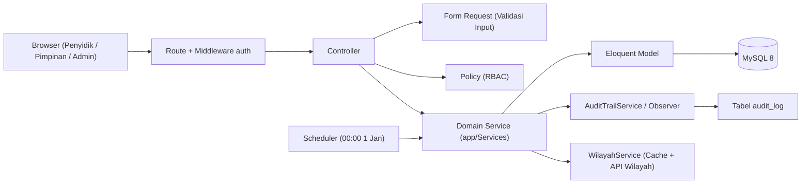
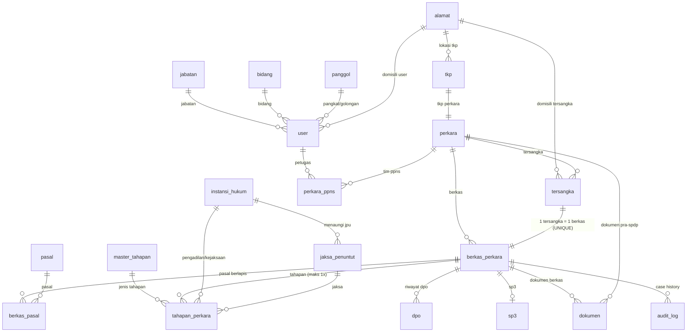
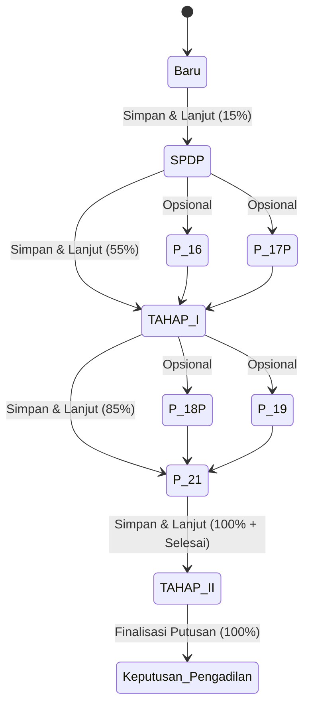

# ARCHITECTURE — BAPTwo

Arsitektur teknis BAPTwo. Aturan bisnis merujuk ke `PRD.md`; log keputusan teknis ke `DECISIONS.md`.

---

## 1. Gambaran Umum

- Monolit **Laravel 12** server-rendered (Blade + Alpine.js + Tailwind CSS v4) di atas template TailAdmin.
- Satu database **MySQL 8** (D-001).
- Single locale **id** (Bahasa Indonesia) dan tata letak **LTR saja** (D-003, D-004).
- Tidak ada API publik. Integrasi eksternal hanya **API Kode Wilayah** (PRD F-37).

---

## 2. Lapisan & Tanggung Jawab

| Lapisan | Lokasi | Tanggung Jawab |
|---|---|---|
| **Controller** | `app/Http/Controllers` | Terima HTTP request, delegasikan ke Form Request / Policy / Service, kembalikan response Blade/JSON/Redirect. Tanpa aturan bisnis. |
| **Form Request** | `app/Http/Requests` | Validasi tipe, format, dan kelengkapan field input dari pengguna. |
| **Policy** | `app/Policies` | Otorisasi hak akses per role pengguna (Perkara, BerkasPerkara, Dokumen, User). |
| **Domain Service** | `app/Services` | Pusat seluruh aturan bisnis: transisi tahapan, kalkulasi progress, penguncian, DPO gate, trigger formal, audit trail. |
| **Model** | `app/Models` | Definisi tabel, relasi Eloquent, casting atribut, soft delete, scope query. |
| **Enum** | `app/Enums` | Representasi tipe statis: role, tahapan, status proses, status formal. |
| **Event / Observer** | `app/Observers` | Pemicu audit trail otomatis pada mutasi record domain. |
| **View & Component** | `resources/views` | Template Blade modular TailAdmin, Alpine.js untuk interaktivitas, teks UI via `__()` dan `lang/id.json`. |

---

## 3. Model Data & Skema Database

Semua tabel domain wajib memiliki kolom `created_by`, `updated_by`, dan `deleted_at` (`SoftDeletes`).

### 3.1 Relasi Entitas (ERD)

### 3.2 Spesifikasi Tabel (18 Tabel Singular)

1. **`alamat`** (Sinkronisasi `https://api.kodewilayah.web.id` — D-009)
   - `id`: bigint unsigned, PK
   - `provinsi_kode`, `provinsi_nama`: string(15), string(100), nullable
   - `kabupaten_kode`, `kabupaten_nama`: string(15), string(100), nullable
   - `kecamatan_kode`, `kecamatan_nama`: string(15), string(100), nullable
   - `desa_kode`, `desa_nama`: string(15), string(100), nullable
   - `rt`, `rw`: string(5), nullable
   - `alamat_detail`: string(255), nullable
   - `created_at`, `updated_at`

2. **`jabatan`**, **`bidang`**, **`panggol`**
   - `jabatan`: `id`, `nama_jabatan` (unique), `created_at`, `updated_at`
   - `bidang`: `id`, `nama_bidang` (unique), `created_at`, `updated_at`
   - `panggol`: `id`, `pangkat`, `golongan`, `created_at`, `updated_at`

3. **`user`**
   - `id`: bigint unsigned, PK
   - `role`: enum (`administrator`, `pimpinan`, `penyidik`), default `penyidik`
   - `jabatan_id`: FK -> `jabatan.id`, nullable
   - `bidang_id`: FK -> `bidang.id`, nullable
   - `panggol_id`: FK -> `panggol.id`, nullable
   - `alamat_id`: FK -> `alamat.id`, nullable
   - `nama`: string(150)
   - `nip`: string(30), unique
   - `email`: string(255), unique
   - `password`: string(255)
   - `foto_profil`: string(255), nullable
   - `tempat_lahir`: string(100), nullable
   - `tanggal_lahir`: date, nullable
   - `jenis_kelamin`: enum (`laki-laki`, `perempuan`), nullable
   - `status_pernikahan`: enum (`belum_kawin`, `kawin`, `cerai_hidup`, `cerai_mati`), nullable
   - `no_telp`: string(25), nullable
   - `status`: enum (`pns`, `pppk`, `lainnya`), default `pns`
   - `is_active`: boolean, default true
   - `created_by`, `updated_by`: bigint unsigned, nullable
   - `created_at`, `updated_at`, `deleted_at`

4. **`tkp`**
   - `id`: bigint unsigned, PK
   - `alamat_id`: FK -> `alamat.id`
   - `klasifikasi`: enum (`retailer`, `distributor`)
   - `legalitas`: enum (`legal`, `ilegal`)
   - `modus`: enum (`online`, `offline`)
   - `created_by`, `updated_by`: bigint unsigned, nullable
   - `created_at`, `updated_at`, `deleted_at`

5. **`perkara`** (Informasi Pra-SPDP Lean)
   - `id`: bigint unsigned, PK
   - `nomor_laporan_kejadian`: string(100)
   - `tanggal_laporan_kejadian`: date
   - `nomor_surat_perintah`: string(100)
   - `tanggal_surat_perintah`: date
   - `tkp_id`: FK -> `tkp.id`
   - `deskripsi`: text, nullable
   - `created_by`, `updated_by`: bigint unsigned, nullable
   - `created_at`, `updated_at`, `deleted_at`

6. **`perkara_ppns`**
   - `perkara_id`: FK -> `perkara.id`, ON DELETE CASCADE
   - `user_id`: FK -> `user.id`
   - `peran`: enum (`utama`, `anggota`)
   - PRIMARY KEY (`perkara_id`, `user_id`)

7. **`tersangka`**
   - `id`: bigint unsigned, PK
   - `perkara_id`: FK -> `perkara.id`, ON DELETE CASCADE
   - `nama`: string(150)
   - `alias`, `bin_binti`: string, nullable
   - `nik`: string(20), nullable
   - `tempat_lahir`, `tanggal_lahir`: nullable
   - `jenis_kelamin`: enum (`laki-laki`, `perempuan`)
   - `agama`: enum agama
   - `pekerjaan`, `kewarganegaraan`: string
   - `alamat_id`: FK -> `alamat.id`, nullable
   - `created_by`, `updated_by`: bigint unsigned, nullable
   - `created_at`, `updated_at`, `deleted_at`

8. **`berkas_perkara`** (Inti Tracking & SLA)
   - `id`: bigint unsigned, PK
   - `perkara_id`: FK -> `perkara.id`, ON DELETE CASCADE
   - `tersangka_id`: FK -> `tersangka.id`, UNIQUE (1 tersangka = 1 berkas)
   - `nomor_berkas`: string(150) (input manual tanpa pola, PRD F-33)
   - `tanggal_spdp`: date, nullable (titik awal perhitungan SLA & tahun batas)
   - `status_formal`: enum (`selesai`, `tidak_selesai`), nullable (null = "Dalam Proses")
   - `status_proses`: string(50), default 'Baru' (mengikuti tahapan final terakhir)
   - `progress_persen`: unsigned tinyint, default 0 (0, 15, 55, 85, 100)
   - `is_dpo`: boolean, default false
   - `sla_deadline`: date, nullable (tanggal_spdp + 1 bulan atau 31 Desember)
   - `created_by`, `updated_by`: bigint unsigned, nullable
   - `created_at`, `updated_at`, `deleted_at`

9. **`pasal`** & **`berkas_pasal`** (Pasal Berlapis)
   - `pasal`: `id`, `nama_pasal`, `pasal`, `nomor`, `tahun`, `isi`, `status`, `created_at`, `updated_at`, `deleted_at`
   - `berkas_pasal`: `berkas_perkara_id` (FK), `pasal_id` (FK), PK compound

10. **`master_tahapan`**, **`instansi_hukum`**, **`jaksa_penuntut`**
    - `master_tahapan`: `id`, `kode_tahap` (unique), `nama_tahapan`, `bobot_kumulatif`, `urutan`, `is_opsional`, `created_at`, `updated_at`
    - `instansi_hukum`: `id`, `jenis` enum(`pengadilan`, `kejaksaan`), `nama` string(150), `wilayah` string(100), `created_at`, `updated_at`
    - `jaksa_penuntut`: `id`, `instansi_hukum_id` (FK -> `instansi_hukum.id`), `nama_jaksa` string(225), `created_at`, `updated_at`

11. **`tahapan_perkara`**
    - `id`: bigint unsigned, PK
    - `berkas_perkara_id`: FK -> `berkas_perkara.id`, ON DELETE CASCADE
    - `master_tahapan_id`: FK -> `master_tahapan.id`
    - `instansi_hukum_id`: FK -> `instansi_hukum.id`, nullable
    - `jaksa_penuntut_id`: FK -> `jaksa_penuntut.id`, nullable
    - `nomor`: string(150), nullable
    - `status`: enum (`draft`, `final`), default `draft`
    - `tanggal`: date, nullable
    - `catatan`: text, nullable
    - `data_tambahan`: json, nullable
    - `locked_at`: timestamp, nullable
    - `finalized_by`: FK -> `user.id`, nullable
    - `created_by`, `updated_by`: bigint unsigned, nullable
    - `created_at`, `updated_at`, `deleted_at`
    - UNIQUE KEY (`berkas_perkara_id`, `master_tahapan_id`) -> F-11 maks 1 kali per tahap

12. **`dokumen`** (Sentralisasi File Wajib PDF — D-007)
    - `id`: bigint unsigned, PK
    - `perkara_id`: FK -> `perkara.id`, nullable
    - `berkas_perkara_id`: FK -> `berkas_perkara.id`, nullable
    - `tahapan_perkara_id`: FK -> `tahapan_perkara.id`, nullable
    - `kategori`: enum (`lapkej`, `sprindik`, `spdp`, `tahapan`, `dpo`, `sp3`, `lainnya`)
    - `nama_dokumen`: string(150)
    - `nama_file_asli`: string(255)
    - `file_path`: string(500) (storage privat)
    - `file_size`: bigint unsigned
    - `created_by`, `updated_by`: bigint unsigned, nullable
    - `created_at`, `updated_at`, `deleted_at`

13. **`dpo`** & **`sp3`**
    - `dpo`: `id`, `berkas_perkara_id` (FK), `nomor_surat`, `tanggal_aktif`, `tanggal_nonaktif`, `keterangan`, `dokumen_id` (FK), `created_by`, `updated_by`, `created_at`, `updated_at`, `deleted_at`
    - `sp3`: `id`, `berkas_perkara_id` (FK, UNIQUE), `nomor`, `tanggal`, `alasan`, `dokumen_id` (FK), `created_by`, `updated_by`, `created_at`, `updated_at`, `deleted_at`

14. **`audit_log`** (Case History & Scheduler-Ready)
    - `id`: bigint unsigned, PK
    - `user_id`: FK -> `user.id`, nullable (NULL saat pemicu cron 1 Januari)
    - `perkara_id`: FK -> `perkara.id`, nullable
    - `berkas_perkara_id`: FK -> `berkas_perkara.id`, nullable (Index cepat case history)
    - `aksi`: string(100)
    - `tabel`: string(100)
    - `record_id`: bigint unsigned
    - `data_lama`: json, nullable
    - `data_baru`: json, nullable
    - `ip_address`: string(45), nullable
    - `created_at`: timestamp, default CURRENT_TIMESTAMP

---

## 4. Enum Domain

Lokasi: `app/Enums/`. Menggunakan PHP 8.2 Backed Enums:

### 4.1 `UserRole`
- `ADMINISTRATOR = 'administrator'`
- `PIMPINAN = 'pimpinan'`
- `PENYIDIK = 'penyidik'`

### 4.2 `JenisTahap`
Urutan workflow resmi:
1. `SPDP = 'SPDP'` (Bobot kumulatif: 15% — Titik awal progress)
2. `P_16 = 'P-16'` (Opsional, penunjukan JPU, tanpa bobot)
3. `P_17 = 'P-17/P-17P'` (Opsional, permintaan perkembangan penyidikan, tanpa bobot)
4. `TAHAP_I = 'TAHAP I'` (Bobot kumulatif: 55%, kontribusi: +40%)
5. `P_18 = 'P-18/P-18P'` (Opsional, hasil penyidikan belum lengkap, tanpa bobot)
6. `P_19 = 'P-19'` (Opsional, pengembalian berkas & petunjuk jaksa, tanpa bobot)
7. `P_20 = 'P-20'` (Opsional, pemberitahuan waktu penyidikan habis, tanpa bobot)
8. `P_21 = 'P-21/P-21a'` (Bobot kumulatif: 85%, kontribusi: +30%)
9. `TAHAP_II = 'TAHAP II'` (Bobot kumulatif: 100%, kontribusi: +15% — Pemicu otomatis status Selesai)
10. `KEPUTUSAN_PENGADILAN = 'Keputusan Pengadilan'` (Setelah Tahap II, tetap 100%)

### 4.3 `StatusProses`
- `BARU = 'Baru'`
- Semua nilai di `JenisTahap` (mengikuti tahapan terakhir yang difinalkan).

### 4.4 `StatusFormal`
- `SELESAI = 'Selesai'`
- `TIDAK_SELESAI = 'Tidak Selesai'`
- Catatan: `null` di database ditampilkan di UI sebagai badge `"Dalam Proses"`.

---

## 5. Alur Tahapan & Logika State Machine

Semua transisi tahap dikontrol oleh `App\Services\TahapanService`:

### 5.1 Aksi Tombol pada Setiap Tahap
1. **Batal**: Keluar tanpa menulis ke database.
2. **Draft**: Simpan form apa adanya (`status = 'draft'`). Tidak menaikkan tahap, tidak mengubah `status_proses`, tidak menambah persentase progress, data tetap dapat diedit.
3. **Simpan & Lanjut Tahap Berikutnya**:
   - Server memvalidasi seluruh field wajib tahap tersebut.
   - Record tahap di-update: `status = 'final'`, `locked_at = now()`, `finalized_by = auth()->id()`.
   - Data tahap **dikunci permanen** (tidak dapat diedit lagi oleh Penyidik maupun Administrator).
   - `berkas_perkara.status_proses` diperbarui ke jenis tahap ini.
   - `berkas_perkara.progress_persen` diperbarui sesuai bobot milestone tertinggi yang telah dicapai.
   - Jika tahap adalah `TAHAP II`: server otomatis mengeset `berkas_perkara.status_formal = 'selesai'`.
   - Menulis log ke `audit_log`.

### 5.2 Aturan DPO Gate
- DPO dapat diaktifkan kapan saja oleh Penyidik melalui modal/toggle DPO.
- Saat `berkas_perkara.is_dpo == true`:
  - Tombol **"Simpan & Lanjut ke Tahap 2 (Pelimpahan Tersangka & Barang Bukti)"** diberi atribut `disabled` di UI Blade.
  - Server di `TahapanService` menolak eksekusi finalisasi `TAHAP_II` dengan exception `ValidationException` ("Tidak dapat melimpahkan tersangka saat berstatus DPO").
  - Tahapan lain sebelum Tahap II tetap dapat dikerjakan.
  - SLA dan batas akhir tahun **tetap berjalan (tidak dijeda)**.

---

## 6. Hak Akses & Keamanan (RBAC)

Otorisasi menggunakan Laravel **Gate** dan **Policy** bawaan (`App\Policies\`):

| Model / Fitur | Penyidik | Pimpinan | Administrator |
|---|:---:|:---:|:---:|
| Lihat Seluruh Perkara & Berkas | ✅ | ✅ | ✅ |
| Tambah Perkara / Berkas Baru | ✅ | ❌ | ✅ |
| Edit Form Tahap (Draft) | ✅ | ❌ | ✅ |
| Finalisasi Tahap (Simpan & Lanjut) | ✅ | ❌ | ❌ (Hanya Penyidik pemegang berkas/tim) |
| Edit Tahap yang Sudah Difinalkan | ❌ (Terkunci) | ❌ (Terkunci) | ❌ (Terkunci mutlak) |
| Toggle DPO (Aktifkan / Nonaktifkan) | ✅ | ❌ | ✅ |
| Unggah Dokumen / SP3 | ✅ | ❌ | ✅ |
| Soft Delete Perkara / Berkas | ✅ | ❌ | ✅ |
| Hard Delete (Penghapusan Fisik) | ❌ (Dilarang) | ❌ (Dilarang) | ❌ (Dilarang) |
| Manajemen User & Hak Akses | ❌ | ❌ | ✅ |

---

## 7. Scheduler & Pergantian Tahun

- **Command Artisan**: `php artisan berkas:tutup-akhir-tahun` (`App\Console\Commands\TutupBerkasAkhirTahunCommand`).
- **Jadwal Eksekusi**: Tepat pukul `00:00:00` pada tanggal `1 Januari` setiap tahun.
- **Timezone**: `Asia/Makassar` (WITA — zona waktu BPOM Kalimantan Selatan).
- **Logika**:
  - Ambil semua `berkas_perkara` yang memiliki `tanggal_spdp` sebelum 1 Januari tahun berjalan DAN `status_formal IS NULL`.
  - Update `status_formal = 'tidak_selesai'`.
  - Tulis entri `audit_log` otomatis dengan aktor sistem (`user_id = null`): `"Otomatisasi akhir tahun: Berkas ditutup dengan status Tidak Selesai karena melewati batas tahun SPDP"`.
  - Mengirim ringkasan ke log aplikasi.

---

## 8. Dokumen & Media Storage

- Dokumen perkara tidak boleh ditempatkan di direktori `public/`.
- Disimpan di disk privat: `storage/app/private/dokumen_perkara/{berkas_id}/`.
- Nama file di-sanitize dengan UUID/timestamp acak untuk mencegah path traversal dan konflik nama. Nama asli disimpan di `dokumen.nama_file_asli`.
- Batas ukuran upload: maksimal **20 MB** per berkas.
- Tipe file diizinkan: **PDF saja** (`application/pdf`, ekstensi `.pdf`). Format selain PDF ditolak oleh validasi server (D-007).
- Unduh dokumen hanya lewat route terproteksi controller `DokumenController@download` yang memvalidasi `Gate::authorize('view', $berkas)`.

---

## 9. Integrasi Eksternal (`https://api.kodewilayah.web.id`)

- Dikelola oleh `App\Services\WilayahService` (D-009).
- Base URL: `https://api.kodewilayah.web.id` (format response: `{ "success": true, "data": [{ "code": 63, "name": "Kalimantan Selatan" }] }`).
- Endpoint hierarki BPS:
  - Provinsi: `GET /provinces` (2 digit, mis. `63`)
  - Kabupaten/Kota: `GET /regencies/{provinsi_kode}` (4 digit, mis. `6371`)
  - Kecamatan: `GET /districts/{kabupaten_kode}` (6 digit, mis. `637101`)
  - Kelurahan/Desa: `GET /villages/{kecamatan_kode}` (10 digit, mis. `6371011001`)
- **Strategi Caching & Proxy**: Browser memanggil endpoint internal Laravel (`/api/wilayah/...`), lalu `WilayahService` melakukan cache response selama 30 hari menggunakan `Cache::remember('wilayah_...', 30 days)`.
- **Ketahanan (Snapshot Pattern)**: Saat formulir disimpan ke tabel `alamat`, server otomatis mencocokkan `*_kode` terhadap cache untuk mengisi `provinsi_nama`, `kabupaten_nama`, `kecamatan_nama`, dan `desa_nama`. Data historis perkara tetap utuh meskipun API eksternal sedang down atau terjadi pemekaran wilayah di masa depan.

---

## 10. Pengujian (Testing Strategy)

- Test framework: **Pest PHP** (`composer test`).
- Database test: Menggunakan konfigurasi `sqlite` in-memory (`:memory:`) di `phpunit.xml` agar tes berjalan instan tanpa bergantung Laragon/MySQL berjalan.
- Standar pengujian mencakup:
  1. Unit test service logika bobot progress, transisi status, dan SLA.
  2. Feature test otorisasi role (Penyidik vs Pimpinan vs Admin).
  3. Feature test DPO gate dan penguncian tahap (memastikan tahap tidak bisa diedit setelah final).
  4. Feature test trigger otomatis status formal (Selesai pada Tahap II, Tidak Selesai pada scheduler pergantian tahun).
