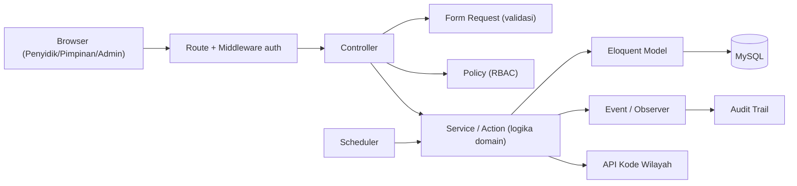
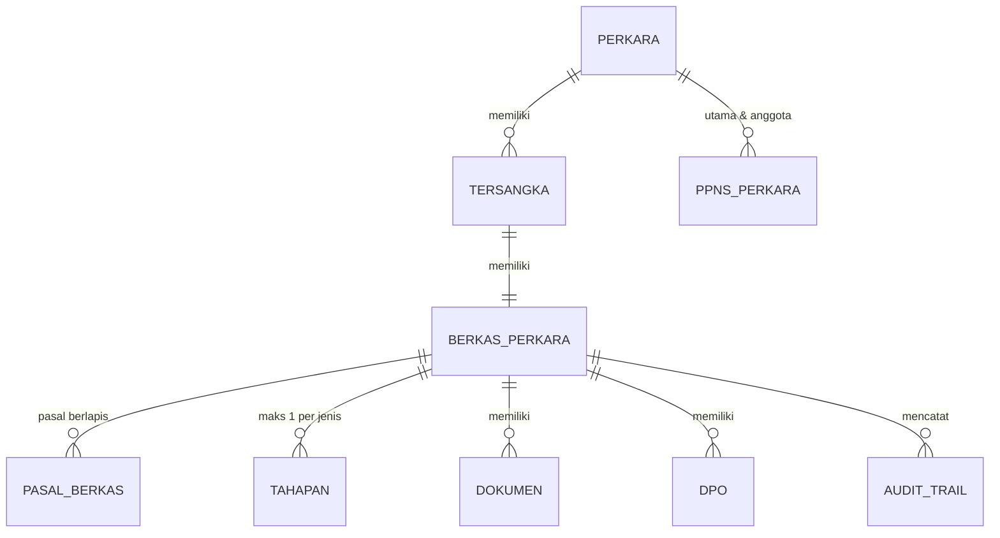

# ARCHITECTURE — BAPTwo

Arsitektur teknis BAPTwo. Aturan bisnis ada di `PRD.md`; keputusan teknis di `DECISIONS.md`.

> **Status: kerangka.** Bagian bertanda **TBD** diisi bertahap (lihat `TASKS.md` T-005). Jangan mengarang isi TBD tanpa diskusi.

---

## 1. Gambaran Umum

- Monolit Laravel 12 server-rendered (Blade + Alpine.js) di atas template TailAdmin.
- Satu database MySQL 8 (D-001).
- Tidak ada API publik. Tidak ada integrasi sistem lain kecuali API Kode Wilayah (PRD F-37).

## 2. Lapisan & Tanggung Jawab

| Lapisan | Lokasi | Tanggung jawab |
|---|---|---|
| Controller | `app/Http/Controllers` | Terima request, panggil Service, kembalikan view/redirect. Tanpa logika domain. |
| Form Request | `app/Http/Requests` | Semua validasi input. |
| Policy | `app/Policies` | Hak akses per role (Perkara, BerkasPerkara, Dokumen, User). |
| Service / Action | `app/Services` atau `app/Actions` (**TBD**: pilih satu) | Progress, status proses, urutan tahap, penguncian, DPO gate, trigger status. |
| Model | `app/Models` | Relasi, cast, scope. Tanpa aturan bisnis. |
| Event / Observer | `app/Events`, `app/Observers` | Menulis audit trail. |
| Enum | `app/Enums` | Tahapan, status proses, status formal, role. |
| View | `resources/views` | Blade TailAdmin, label via `__()` + `lang/id.json`. |

## 3. Model Data

**TBD** — ERD lengkap diisi di T-005. Entitas yang sudah pasti dari PRD:

Aturan kolom wajib semua tabel domain: `created_by`, `updated_by`, `deleted_at` (soft delete).

Pertanyaan terbuka:
- Penyimpanan alamat wilayah: simpan kode saja atau kode + nama (snapshot)? **TBD**
- Struktur tabel tahapan: satu tabel generik + kolom JSON per jenis, atau tabel per jenis tahap? **TBD**

## 4. Enum Domain

| Enum | Nilai | Sumber |
|---|---|---|
| Jenis Tahapan | `SPDP`, `P-16`, `P-17P`, `TAHAP I`, `P-18P`, `P-19`, `P-21/P21a`, `TAHAP II`, `Keputusan Pengadilan` | PRD F-10 |
| Status Proses | `Baru` + semua nilai Jenis Tahapan | PRD Status Proses |
| Status Formal | `Selesai`, `Tidak Selesai` (null = tampil "Dalam Proses") | PRD F-20, F-21 |
| Role | `Penyidik`, `Pimpinan`, `Administrator` | PRD Hak Akses |

Bobot progress: SPDP 15, TAHAP I 55, P-21/P21a 85, TAHAP II 100. Lainnya tanpa bobot.

## 5. Alur Tahapan

- Urutan, opsional, maksimal 1x, dan penguncian divalidasi di Service (server), bukan hanya UI.
- Aksi: Batal (tanpa request simpan), Draft (simpan tanpa finalisasi), Simpan & Lanjut (validasi wajib + finalisasi + kunci).
- DPO aktif → finalisasi menuju TAHAP II ditolak di server.
- Detail state machine: **TBD**.

## 6. RBAC

- Auth Laravel bawaan + Policy/Gate.
- Mekanisme penyimpanan role/permission: **TBD** (kolom `role` di `users` vs package permission — package butuh persetujuan).

## 7. Scheduler

- Job "Tidak Selesai": jalan 00:00 tanggal 1 Januari, zona waktu **TBD** (kandidat `Asia/Makassar`, WITA).
- Mengubah Berkas tahun SPDP sebelumnya yang belum Selesai menjadi Tidak Selesai + tulis audit trail.
- Produksi wajib menjalankan `php artisan schedule:run` tiap menit (cron / Task Scheduler).

## 8. Dokumen & Storage

- Disk penyimpanan, batas ukuran, dan tipe file: **TBD**.
- Dokumen tidak boleh diakses publik; unduh lewat controller + Policy.

## 9. Audit Trail

- Dicatat untuk: perubahan status, finalisasi tahap, upload dokumen, DPO on/off, soft delete/restore.
- Field minimum: berkas, aksi, data sebelum/sesudah (**TBD** format), user, timestamp.

## 10. Integrasi Eksternal

- API Kode Wilayah: endpoint, caching, dan fallback saat API mati **TBD**.

## 11. Testing

- Pest PHP (`composer test`). Prioritas: Feature test untuk aturan domain dan akses tiap role.
- Database test (SQLite in-memory vs MySQL terpisah): **TBD**.

## 12. Deployment

**TBD** — server, versi PHP, queue worker, cron scheduler, backup.
