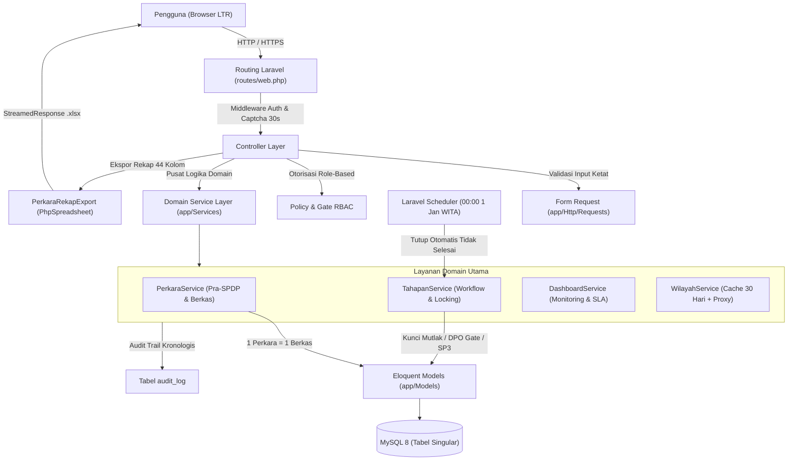
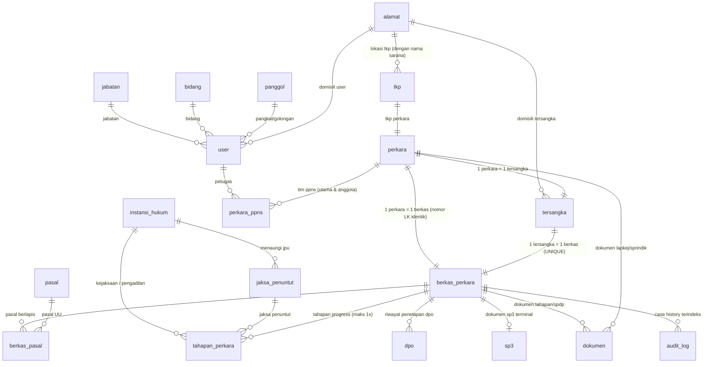
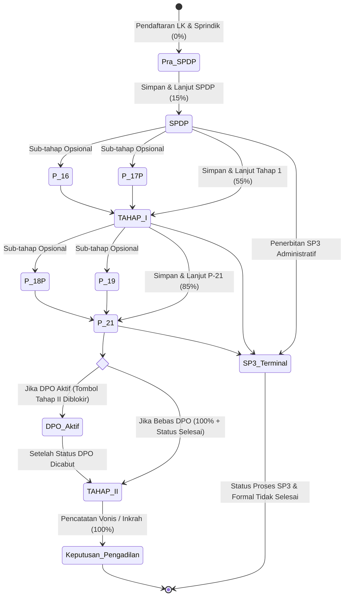

# ARCHITECTURE — BAPTwo

Arsitektur teknis BAPTwo. Aturan bisnis merujuk ke `PRD.md`; log keputusan teknis ke `DECISIONS.md`.

---

## 1. Gambaran Umum

- Monolit **Laravel 12** server-rendered (Blade + Alpine.js + Tailwind CSS v4) di atas template TailAdmin yang telah dirampingkan bersih (D-036, D-037).
- Satu database **MySQL 8** di lingkungan Laragon (D-001).
- Single locale **id** (Bahasa Indonesia) dan tata letak **LTR saja** (D-003, D-004).
- Tidak ada API publik. Integrasi eksternal hanya proxy **API Kode Wilayah** (`https://api.kodewilayah.web.id`) dengan fallback JSON offline (PRD F-37, D-015).
- Ekspor resmi pelaporan rekap perkara format Excel (.xlsx) 44 kolom terstandarisasi BPOM (D-035 Poin 10, D-039).

---

## 2. Lapisan & Tanggung Jawab

| Lapisan | Lokasi | Tanggung Jawab |
|---|---|---|
| **Controller** | `app/Http/Controllers` | Menerima HTTP request, memanggil Form Request / Policy / Service, mengembalikan response Blade/JSON/Redirect/Streamed Excel. Bersih dari logika bisnis. |
| **Form Request** | `app/Http/Requests` | Validasi tipe, format, digit (mis. NIK 16 digit), batasan berkas PDF (max 5 MB), dan kelengkapan field input pengguna. |
| **Policy & Gate** | `app/Policies` & `AppServiceProvider` | Otorisasi hak akses berbasis peran (Penyidik, Pimpinan, Administrator) termasuk gate `export-excel` dan pembatasan Master Data. |
| **Domain Service** | `app/Services` | Pusat seluruh aturan bisnis: transisi tahapan progress, kalkulasi bobot (0%, 15%, 55%, 85%, 100%), penguncian permanen, DPO gate, trigger formal, dan audit trail. |
| **Model** | `app/Models` | Definisi tabel singular (`protected $table = '...'`), relasi Eloquent, accessor (`alamat_lengkap`), casting, dan soft deletes. |
| **Enum** | `app/Enums` | Representasi tipe aman PHP 8.2: `UserRole`, `JenisTahap`, `StatusProses`, `StatusFormal`. |
| **Export Engine** | `app/Exports` | Generator dokumen Excel (.xlsx) 44 kolom resmi: 4 baris header, format tanggal `dd-mmm-yy`, border, wrap text, dan freeze pane A5. |
| **View & Component** | `resources/views` | Template Blade modular TailAdmin, interaktivitas Alpine.js, icon resmi Flaticon (`fi fi-rr-*`), teks UI via `__()` dan `lang/id.json`. |

---

## 3. Model Data & Skema Database

Semua tabel domain wajib menggunakan nama **singular `snake_case` Bahasa Indonesia** (D-008, D-009) dan menyertakan kolom `created_by`, `updated_by`, serta `deleted_at` (`SoftDeletes`).

### 3.1 Relasi Entitas (ERD Mutakhir)

### 3.2 Spesifikasi Tabel Utama

1. **`alamat`** (D-009, D-015, D-039)
   - `id`: bigint unsigned, PK
   - `nama`: string(150), nullable (nama toko, kios, gudang, atau sarana usaha TKP)
   - `provinsi_kode`, `provinsi_nama`: string(15), string(100), nullable (Kalsel = 63)
   - `kabupaten_kode`, `kabupaten_nama`: string(15), string(100), nullable
   - `kecamatan_kode`, `kecamatan_nama`: string(15), string(100), nullable
   - `desa_kode`, `desa_nama`: string(15), string(100), nullable
   - `rt`, `rw`: string(5), nullable
   - `alamat_detail`: string(255), nullable
   - `created_at`, `updated_at`
   - *Accessor*: `alamat_lengkap` (format gabungan utuh jalan + RT/RW + Desa + Kec + Kab + Prov).

2. **`user`** (D-005, D-008)
   - `id`: bigint unsigned, PK
   - `role`: enum (`administrator`, `pimpinan`, `penyidik`, `umum`), default `penyidik`
   - `jabatan_id`, `bidang_id`, `panggol_id`, `alamat_id`: FK nullable
   - `nama`: string(150), `nip`: string(30) nullable unique, `email`: string(255) unique
   - `password`: string(255)
   - `is_active`: boolean, default true
   - `created_by`, `updated_by`, `created_at`, `updated_at`, `deleted_at`

3. **`tkp`** (Tempat Kejadian Perkara — D-035 Poin 3)
   - `id`: bigint unsigned, PK
   - `alamat_id`: FK -> `alamat.id`
   - `klasifikasi`: enum (`retailer`, `distributor`)
   - `legalitas`: enum (`legal`, `ilegal`) — via radio button UI
   - `modus`: enum (`online`, `offline`) — via radio button UI
   - `created_by`, `updated_by`, `created_at`, `updated_at`, `deleted_at`

4. **`perkara`** (Informasi Pra-SPDP — D-035 Poin 5)
   - `id`: bigint unsigned, PK
   - `nomor_laporan_kejadian`: string(100), unique
   - `tanggal_laporan_kejadian`: date
   - `tahap_laporan_status`: enum (`draft`, `final`)
   - `nomor_surat_perintah`: string(100), unique nullable
   - `tanggal_surat_perintah`: date nullable
   - `tahap_sprindik_status`: enum (`draft`, `final`) nullable
   - `tahap_perkara_status`: enum (`draft`, `final`) nullable
   - `tkp_id`: FK -> `tkp.id` nullable
   - `deskripsi`: text, nullable
   - `created_by`, `updated_by`, `created_at`, `updated_at`, `deleted_at`

5. **`tersangka`** (D-035 Poin 8, 17)
   - `id`: bigint unsigned, PK
   - `perkara_id`: FK -> `perkara.id`, ON DELETE CASCADE
   - `nama`: string(150), `alias`: string(150) nullable, `bin_binti`: string(150) nullable
   - `nik`: string(20) nullable (wajib tepat 16 digit pada finalisasi)
   - `tempat_lahir`, `tanggal_lahir`, `jenis_kelamin`, `agama`, `pekerjaan`, `kewarganegaraan` (default 'WNI')
   - `alamat_id`: FK -> `alamat.id` nullable
   - `created_by`, `updated_by`, `created_at`, `updated_at`, `deleted_at`

6. **`berkas_perkara`** (Tracking, SLA & Progress — D-035 Poin 5, 11)
   - `id`: bigint unsigned, PK
   - `perkara_id`: FK -> `perkara.id`, ON DELETE CASCADE
   - `tersangka_id`: FK -> `tersangka.id`, UNIQUE (1 tersangka = 1 berkas)
   - `nomor_berkas`: string(150) — **Wajib identik dengan nomor Laporan Kejadian**
   - `tanggal_spdp`: date, nullable (titik awal perhitungan SLA & tahun batas)
   - `status_formal`: enum (`selesai`, `tidak_selesai`), nullable (`null` = label "Dalam Proses")
   - `status_proses`: string(50), default 'Baru' (mengikuti tahapan final terakhir, atau 'SP3')
   - `progress_persen`: unsigned tinyint, default 0 (0, 15, 55, 85, 100)
   - `is_dpo`: boolean, default false
   - `sla_deadline`: date, nullable (1 bulan kalender atau batas 31 Desember)
   - `created_by`, `updated_by`, `created_at`, `updated_at`, `deleted_at`

7. **`dokumen`** (Sentralisasi File Wajib PDF — D-007, D-035 Poin 18)
   - `id`: bigint unsigned, PK
   - `perkara_id`, `berkas_perkara_id`, `tahapan_perkara_id`: FK nullable
   - `kategori`: enum (`lapkej`, `sprindik`, `spdp`, `tahapan`, `dpo`, `sp3`, `lainnya`)
   - `nama_dokumen`: string(150), `nama_file_asli`: string(255), `file_path`: string(500)
   - `file_size`: bigint unsigned (maksimum **5 MB** / 5.120 kB pada upload privat)
   - `created_by`, `updated_by`, `created_at`, `updated_at`, `deleted_at`
   - *Viewer Terpadu (D-047)*: Dilengkapi komponen global `<x-common.pdf-preview-modal />` dengan delegated click listener untuk pratinjau instan in-app tanpa meninggalkan konteks halaman.

8. **`sp3`** (Dokumen Penghentian Penyidikan — D-035 Poin 15, 22)
   - `id`: bigint unsigned, PK
   - `berkas_perkara_id`: FK -> `berkas_perkara.id`, UNIQUE
   - `nomor_surat`: string(150)
   - `tanggal`: date
   - `keterangan`: text (input manual uraian pertimbangan penghentian)
   - `dokumen_id`: FK -> `dokumen.id` (file PDF resmi)
   - `created_by`, `updated_by`, `created_at`, `updated_at`, `deleted_at`
   - *Status Terminal*: Penerbitan SP3 langsung mengubah `status_proses = 'SP3'` dan `status_formal = 'tidak_selesai'`, serta mengunci berkas secara permanen.

---

## 4. Alur Tahapan & State Machine

### 4.1 Progress Berbobot Kumulatif
- **Pra-SPDP**: 0%
- **SPDP**: 15% (titik awal perhitungan SLA 1 bulan kalender)
- **TAHAP I**: 55% (+40%)
- **P-21 / P-21a**: 85% (+30%)
- **TAHAP II**: 100% (+15%) ➔ Pemicu otomatis status formal **Selesai**.
- **Keputusan Pengadilan**: Tetap 100% (pencatatan nomor & amar putusan pengadilan inkrah).
- *Sub-tahap opsional*: P-16, P-17P, P-18P, P-19 dicatat terintegrasi tanpa menambah persentase progress mandiri.

### 4.2 Tiga Aksi Setiap Tahap
1. **Batal**: Keluar halaman tanpa mengubah data.
2. **Draft**: Simpan formulir tanpa menaikkan progress, tanpa mengunci tahap.
3. **Simpan & Lanjut**: Wajib mengisi field pokok, mengunci tahap permanen (`locked_at`), menaikkan status proses dan persentase progress.

---

## 5. Hak Akses & Keamanan (RBAC)

| Modul / Aksi | Penyidik | Pimpinan | Administrator |
|---|:---:|:---:|:---:|
| Lihat Seluruh Perkara & Detail Berkas | ✅ | ✅ | ✅ |
| Tambah Laporan Kejadian & Sprindik | ✅ | ❌ | ✅ |
| Buat & Edit Draft Berkas Perkara | ✅ | ❌ | ✅ |
| Finalisasi Tahap (Simpan & Lanjut) | ✅ | ❌ | ❌ (Hanya Penyidik pemegang berkas) |
| Edit Tahap yang Sudah Final | ❌ (Terkunci Mutlak) | ❌ (Terkunci Mutlak) | ❌ (Terkunci Mutlak) |
| Aktivasi & Pencabutan DPO | ✅ | ❌ | ✅ |
| Terbitkan Dokumen SP3 | ✅ | ❌ | ✅ |
| Ekspor Excel 44 Kolom (.xlsx) | ✅ | ❌ | ✅ |
| Akses Menu Progress Perkara | ❌ (Dialihkan ke Seluruh Perkara) | ✅ | ✅ |
| Master Data (Pasal & Instansi) | ✅ (Lihat Saja) | ❌ (403 Forbidden) | ✅ (Penuh) |
| Master Data (Jabatan, Bidang, Panggol) | ❌ (403 Forbidden) | ❌ (403 Forbidden) | ✅ (Penuh) |
| Manajemen Pengguna & Reset Password | ❌ | ❌ | ✅ |
| Soft Delete Perkara / Berkas | ✅ | ❌ | ✅ |
| Hard Delete (Penghapusan Fisik) | ❌ (Dilarang Mutlak) | ❌ (Dilarang Mutlak) | ❌ (Dilarang Mutlak) |

---

## 6. Fitur Pelaporan & Ekspor Excel 44 Kolom

- **Engine**: Menggunakan `PhpOffice\PhpSpreadsheet` via `App\Exports\PerkaraRekapExport`.
- **Spesifikasi Format Resmi**:
  - Format huruf seragam **Arial** di seluruh sheet.
  - **4 Baris Header Gabungan**: Baris 1–3 nama kolom & grup proses, Baris 4 penomoran kolom `1` s.d. `44`.
  - **Freeze Pane**: Terpasang di sel **`A5`** (header tetap terlihat saat scrolling vertikal dan horizontal).
  - **Format Tanggal**: Seluruh kolom tanggal menggunakan format tanggal Excel asli `dd-mmm-yy` (rata tengah).
  - **Pencegahan Sel Kosong**: Nilai kosong otomatis tercetak tanda strip (`'-'`).
  - **Auto Wrap Text**: Diaktifkan pada sel teks dengan perataan vertikal rata atas (`VERTICAL_TOP`).
  - **Hierarki Data Alamat**: Kolom L (Alamat Tersangka) dan Kolom P (Alamat TKP) mencetak alamat lengkap utuh; Kolom O (Nama TKP) mengambil nama sarana dari `alamat.nama`.
  - **Modal Filter 3 Tab**: Ekspor Semua Data, Filter Tahunan, Filter Bulanan, dan Filter Rentang Tanggal tiket pesawat (`tanggal_mulai` s.d. `tanggal_selesai`).

---

## 7. Keamanan Sesi & Otentikasi

- **Captcha Dinamis (Internal)**: Operasi pengurangan acak matematika ($A > B$) yang di-render dalam SVG dinamis dengan distorsi lekukan, multi-font, rotasi/skew, dan kurva noise. Memiliki masa berlaku (**TTL**) ketat **30 detik** disertai peringatan visual sebelum kedaluwarsa.
- **Inaktivitas Sesi 30 Menit**: Middleware `SessionTimeout` memantau aktivitas pengguna; jika tidak ada aksi selama 30 menit, sesi ditutup otomatis dan pengguna dialihkan ke halaman login dengan notifikasi peringatan.
- **Eliminasi "Remember Me"**: Untuk menjamin keamanan data penegakan hukum di fasilitas publik/kantor, fitur checkbox persistensi sesi jangka panjang dinonaktifkan.

---

## 8. Scheduler & Pergantian Tahun

- **Command**: `php artisan berkas:tutup-akhir-tahun` (`TutupBerkasAkhirTahunCommand`).
- **Jadwal Eksekusi**: Tepat tanggal `1 Januari` pukul `00:00:00` WITA (`Asia/Makassar`).
- **Aturan**: Seluruh berkas perkara yang terdaftar di tahun sebelumnya dan belum berstatus `Selesai` otomatis ditutup permanen dengan status formal **Tidak Selesai**. Audit trail dicatat dengan aktor sistem (`user_id = null`).

---

## 9. Testing & Quality Assurance

- Rangkaian pengujian diuji dengan **Pest PHP** (`composer test`) dengan capaian:
  - **162 Automated Feature & Unit Tests** (1.653 assertions) lulus 100%.
  - Zero-warning styling via **Laravel Pint** (`php vendor/bin/pint --test`) pada 141 file PHP.
- **Seeder Idempoten Komprehensif** (`database/seeders/DummyDataSeeder.php`):
  - 20 Perkara dummy komprehensif mencakup Pra-SPDP, SPDP, Tahap 1, P-21, Tahap 2, Putusan PN Martapura & Marabahan, DPO Aktif, DPO Dicabut, SP3 terminal, dan peringatan SLA di 13 Kabupaten/Kota Kalimantan Selatan.
  - 20 Pasal UU (Kesehatan, Pangan, Perlindungan Konsumen, Narkotika, Psikotropika, KUHP).
  - 20 Instansi Hukum (Kejati Kalsel, 13 Kejari, Pengadilan Tinggi, 5 Pengadilan Negeri se-Kalsel).
  - 20 Jaksa Penuntut Umum resmi lengkap NIP dan pangkat/golongan.
