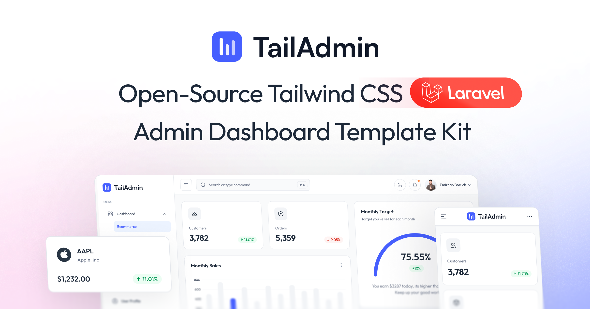

# TailAdmin Laravel — Investigation Case Management Dashboard

A production-ready admin dashboard built on **Laravel 12**, **Tailwind CSS v4**, and **Alpine.js**, based on the [TailAdmin Laravel](https://github.com/TailAdmin/tailadmin-laravel) template and extended with a suite of investigation / case-management modules (Indonesian legal workflow):

- 📋 **Laporan Kejadian** — incident reports (`/laporan-kejadian`)
- 📄 **Sprindik** — assignment orders / surat perintah penyidikan (`/sprindik`)
- ✈️ **SPDP** — notice of commencement of investigation / surat pemberitahuan dimulainya penyidikan (`/spdp`)
- 🔎 **Tahap 1** & **Tahap 2** — two-stage investigation workflow (`/tahap-1`, `/tahap-2`)
- ⚖️ **P-21** — handover of suspect and evidence to the prosecutor (`/p21`)

Each module provides list, create (`/tambah`), and detail (`/{id}`) pages.



## ✨ Features

* 🚀 **Laravel 12 Core** — modern routing, Blade templating, and security out of the box
* 🎨 **Tailwind CSS v4** — utility-first styling configured via `@theme` in `resources/css/app.css`
* ⚡ **Alpine.js Interactivity** — lightweight reactivity without a heavy JS framework
* 🌐 **Localization & RTL** — locale switcher route (`/locale/{locale}`) and right-to-left layout support with persistent direction state
* 📦 **Vite Build System** — fast dev server, HMR, optimized production builds
* 🌙 **Built-in Dark Mode**
* 📊 **Advanced UI Components** — ApexCharts, FullCalendar v7, Swiper, Flatpickr, jsvectormap, data tables, forms, modals
* 🐳 **Official Docker / Laravel Sail support** — PHP 8.4, MySQL 8.0, Redis, Mailpit
* 🧪 **Pest testing** included

## 📋 Requirements

* **PHP 8.2+**
* **Composer**
* **Node.js 18+** and **npm**
* **Database** — SQLite (default), MySQL, or PostgreSQL

Verify your environment:

```bash
php -v
composer -V
node -v
npm -v
```

## 🚀 Quick Start (Local / Native)

```bash
git clone <repository-url> tailadmin-laravel
cd tailadmin-laravel

composer install
npm install

cp .env.example .env        # Windows: copy .env.example .env
php artisan key:generate
```

Configure your database credentials in `.env` (or use the default SQLite), then:

```bash
php artisan migrate
php artisan db:seed         # optional sample data
php artisan storage:link
```

Start the app:

```bash
composer run dev            # server + Vite + queue + logs in one command
```

Or manually, in separate terminals:

```bash
php artisan serve           # http://localhost:8000
npm run dev                 # Vite dev server
```

## 🐳 Docker & Laravel Sail

Pre-configured official Docker support via Laravel Sail (PHP 8.4, MySQL 8.0, Redis, Mailpit). Requires [Docker Desktop](https://www.docker.com/products/docker-desktop/).

```bash
cp .env.example .env
# Ensure container networking is set in .env:
#   DB_HOST=mysql  DB_USERNAME=sail  DB_PASSWORD=password  REDIS_HOST=redis

# Install Composer deps without local PHP:
docker run --rm \
    -u "$(id -u):$(id -g)" \
    -v "$(pwd):/var/www/html" \
    -w /var/www/html \
    laravelsail/php84-composer:latest \
    composer install --ignore-platform-reqs

./vendor/bin/sail up -d
./vendor/bin/sail artisan key:generate
./vendor/bin/sail artisan migrate
./vendor/bin/sail npm install
./vendor/bin/sail npm run dev
```

Access points:

| Service | URL |
| --- | --- |
| Dashboard | http://localhost (or :8000 if `APP_PORT=8000`) |
| Vite Dev Server | http://localhost:5173 (auto-proxied, HMR) |
| Mailpit Web UI | http://localhost:8025 |

Optional shell alias (add to `~/.zshrc` / `~/.bashrc`):

```bash
alias sail='[ -f sail ] && sh sail || sh vendor/bin/sail'
```

## 🧭 Routes

| Path | Description |
| --- | --- |
| `/` | Main dashboard |
| `/laporan-kejadian`, `/tambah`, `/{id}` | Incident reports |
| `/sprindik`, `/tambah`, `/{id}` | Investigation assignment orders |
| `/spdp`, `/tambah`, `/{id}` | SPDP notices |
| `/tahap-1`, `/tambah`, `/{id}` | Investigation stage 1 |
| `/p21`, `/tambah`, `/{id}` | P-21 suspect/evidence handover |
| `/tahap-2`, `/tambah`, `/{id}` | Investigation stage 2 |
| `/calendar`, `/profile`, `/basic-tables`, `/form-elements` | Template pages |
| `/line-chart`, `/bar-chart` | Chart examples |
| `/alerts`, `/avatars`, `/badge`, `/buttons`, `/image`, `/videos` | UI components |
| `/signin`, `/signup`, `/error-404`, `/blank` | Auth & utility pages |
| `/locale/{locale}` | Language switcher |

## 🏗️ Building for Production

```bash
npm run build                       # compile frontend assets
php artisan config:cache
php artisan route:cache
php artisan view:cache
composer install --optimize-autoloader --no-dev
```

Set in `.env`:

```env
APP_ENV=production
APP_DEBUG=false
APP_URL=https://yourdomain.com
```

## 🧪 Testing

```bash
composer run test          # Pest
php artisan test
php artisan test --coverage
php artisan test --filter=ExampleTest
```

## 📜 Useful Commands

```bash
# NPM
npm run dev                # Vite dev server
npm run build              # production build
npm run build:watch        # build in watch mode

# Artisan
php artisan serve
php artisan migrate:fresh --seed
php artisan optimize:clear # clear all caches
php artisan optimize       # cache everything
php artisan route:list
php artisan make:controller YourController
php artisan make:model YourModel -m
```

Formatting via Laravel Pint:

```bash
./vendor/bin/pint
```

## 📁 Project Structure

```
.
├── app/
│   └── Http/
│       ├── Controllers/     # Dashboard, Locale (i18n), Sidebar controllers
│       └── Middleware/
├── config/                  # Laravel configuration
├── database/                # Migrations, seeders, factories
├── public/                  # Entry point (index.php), compiled assets
├── resources/
│   ├── css/app.css          # Tailwind CSS v4 (@theme) configuration
│   ├── js/                  # Alpine.js entrypoint
│   └── views/
│       ├── components/      # Reusable Blade components
│       ├── layouts/         # Dashboard/auth layouts
│       └── pages/           # Dashboard + case-management module pages
├── routes/web.php           # All web routes (dashboard + modules)
├── tests/                   # Pest tests (Feature/Unit)
├── docker-compose.yml       # Laravel Sail configuration
├── vite.config.js           # Vite + Tailwind v4 + container networking
└── .env.example             # Example environment file
```

## 🐛 Troubleshooting

| Problem | Fix |
| --- | --- |
| "Class not found" errors | `composer dump-autoload` |
| Storage/cache permission errors | `chmod -R 775 storage bootstrap/cache` |
| NPM build errors | `rm -rf node_modules package-lock.json && npm install` |
| Stale caches | `php artisan optimize:clear` |
| DB connection errors | Check `.env` credentials; ensure DB server is running and the database exists |
| Docker Vite `ERR_EMPTY_RESPONSE` | Keep `server.host: "0.0.0.0"` and `hmr.host: "localhost"` in `vite.config.js` |

## 🔄 Update Log

### Current Fork
- Added investigation workflow modules: **Laporan Kejadian**, **Sprindik**, **SPDP**, **Tahap 1**, **P-21**, **Tahap 2** (list / create / detail pages each).
- Locale switching and RTL support retained from TailAdmin v1.1.2.

### TailAdmin Base [1.1.2] - 2026-09-02
- FullCalendar upgraded to v7; ApexCharts / Swiper bumped to latest.
- RTL layout support with automatic flipping and toggle; direction state persisted in `localStorage`.
- Improved dropdown behavior and click-outside handling.
- Tailwind CSS v4 optimizations using CSS logical properties.

## 🙏 Credits

Built upon [TailAdmin Laravel](https://github.com/TailAdmin/tailadmin-laravel) — one of the most popular Tailwind CSS admin dashboard templates. Other versions: [Next.js](https://github.com/TailAdmin/free-nextjs-admin-dashboard) · [React](https://github.com/TailAdmin/free-react-tailwind-admin-dashboard) · [Vue](https://github.com/TailAdmin/vue-tailwind-admin-dashboard) · [Angular](https://github.com/TailAdmin/free-angular-tailwind-dashboard).

## License

Refer to our [LICENSE](https://tailadmin.com/license) page for more information.
