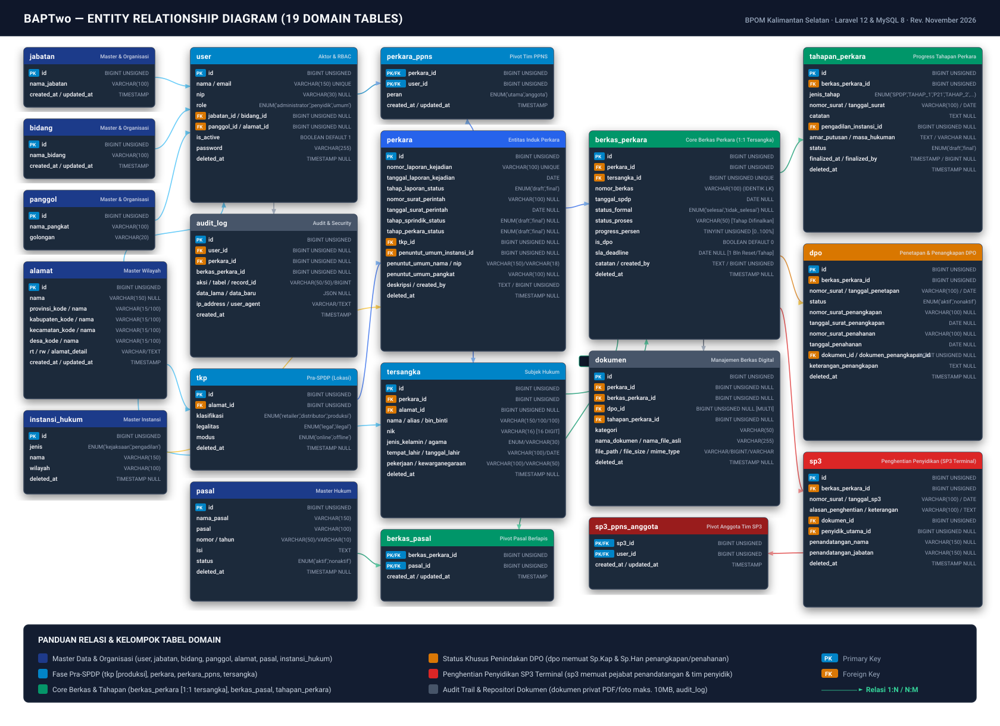
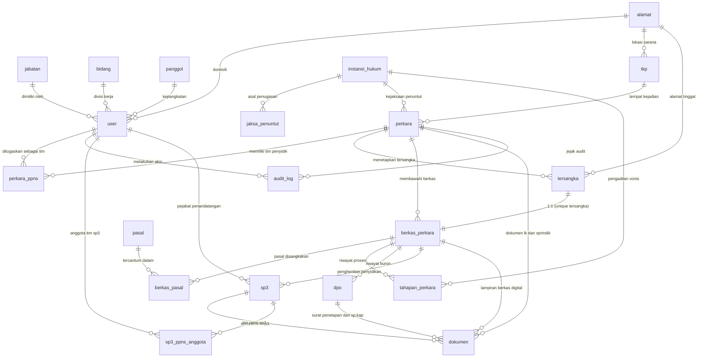

# BAPTwo

Sistem Informasi Manajemen dan Pemantauan Penanganan Perkara Balai Besar POM di Banjarmasin (BPOM Kalimantan Selatan), mengawal pencatatan berkas perkara secara terpadu dari fase awal pra-SPDP hingga Putusan Pengadilan berkekuatan hukum tetap.

[](https://laravel.com)
[](https://www.php.net)
[](https://www.mysql.com)
[](https://tailwindcss.com)
[](https://alpinejs.dev)
[](https://pestphp.com)

---

## Daftar Isi

1. [Dokumen Referensi Proyek](#dokumen-referensi-proyek)
2. [Arsitektur & Aturan Bisnis Inti](#arsitektur--aturan-bisnis-inti)
3. [Skema Database & Diagram ERD](#skema-database--diagram-erd)
4. [Panel Perhitungan Kartu Informasi & Analitik](#panel-perhitungan-kartu-informasi--analitik)
   - [Panel 1: Metrik Dashboard & Widget Analitik](#panel-1-metrik-dashboard--widget-analitik-dashboardservice)
   - [Panel 2: 5 Kartu Ringkasan Informasi Daftar Perkara](#panel-2-5-kartu-ringkasan-informasi-daftar-perkara-perkaraservice)
   - [Panel 3: 4 Kartu Kesiapan Pelimpahan & Rumus SLA](#panel-3-4-kartu-kesiapan-pelimpahan--rumus-sla)
5. [Kebutuhan Sistem](#kebutuhan-sistem)
6. [Instalasi & Setup Lokal](#instalasi--setup-lokal)
7. [Akun Pengembangan & Seeder Data](#akun-pengembangan--seeder-data)
8. [Simulasi Waktu & Pengujian Lintas Tahun](#simulasi-waktu--pengujian-lintas-tahun)
9. [Pengujian Otomatis & Linter](#pengujian-otomatis--linter)
10. [Scheduler & Otomasi Batas Tahun](#scheduler--otomasi-batas-tahun)
11. [Build Produksi](#build-produksi)
12. [Troubleshooting](#troubleshooting)
13. [Lisensi](#lisensi)

---

## Dokumen Referensi Proyek

Seluruh implementasi BAPTwo mengacu pada spesifikasi domain dan keputusan teknis resmi berikut:

| Dokumen | Deskripsi & Kegunaan |
|---|---|
| [`PRD.md`](PRD.md) | *Product Requirements Document*: Sumber kebenaran domain hukum, batas SLA, hak akses RBAC, dan alur penanganan perkara. |
| [`ARCHITECTURE.md`](ARCHITECTURE.md) | Arsitektur teknis sistem: Skema 19 tabel singular, lifecycle tahapan, event audit trail, dan integrasi API wilayah. |
| [`TASKS.md`](TASKS.md) | Daftar pekerjaan aktif dan rekam jejak penyelesaian *task* teknis (T-001 s.d. T-101). |
| [`DECISIONS.md`](DECISIONS.md) | Log keputusan arsitektur dan teknis resmi (*Architecture Decision Records* D-001 s.d. D-079). |
| [`AGENTS.md`](AGENTS.md) | Pedoman kerja otomatisasi, standar koding bebas *AI-slop*, konvensi Blade, dan aturan kontras aksesibilitas. |

---

## Arsitektur & Aturan Bisnis Inti

BAPTwo menerapkan aturan integritas hukum yang ketat untuk menjamin keabsahan data penanganan perkara pidana di bidang Obat dan Makanan:

### 1. Struktur Relasi Entitas
* **1 Perkara = 1 Tersangka = 1 Berkas Perkara**: Setiap berkas perkara berjalan mandiri mewakili satu subjek hukum tersangka.
* **Penomoran Berkas Otomatis**: Nomor Berkas Perkara dibuat identik dengan nomor Laporan Kejadian (LK).
* **Pasal Berlapis**: Setiap berkas perkara dapat memuat kombinasi pasal undang-undang majemuk melalui tabel pivot `berkas_pasal`.

### 2. Dua Fase Penanganan
* **Fase Pra-SPDP (Bobot 0%)**: Meliputi pembuatan Laporan Kejadian (LK), Surat Perintah Penyidikan (Sprindik), penugasan Tim PPNS (Penyidik Utama dan Anggota), penetapan TKP, dan identitas Tersangka.
* **Fase Progress Utama (Bobot Berjenjang)**:
  - **SPDP**: Bobot 15% (Surat Pemberitahuan Dimulainya Penyidikan ke Kejaksaan).
  - **TAHAP I**: Bobot 55% (Penyerahan berkas perkara ke Jaksa Penuntut Umum).
  - **P-21 / P-21A**: Bobot 85% (Pemberitahuan hasil penyidikan telah lengkap dari Kejaksaan).
  - **TAHAP II**: Bobot 100% (Penyerahan tersangka dan barang bukti ke Kejaksaan, otomatis memicu status formal **Selesai**).
  - **Keputusan Pengadilan**: Pencatatan vonis dan vonis hukuman setelah Tahap II selesai (progres tetap 100%, mengunci perkara permanen).
* **Sub-Tahap Bebas (P-16, P-17P, P-18P, P-19)**: Berkas administratif Kejaksaan yang dapat dicatat mandiri kapan saja melalui modal pop-up tanpa menghambat pelompatan tahapan utama.

### 3. Integritas Penguncian & Keamanan Data
* **Penguncian Tahap Mutlak (*Immutable Finalized Stage*)**: Tahapan perkara yang telah difinalkan (*Simpan & Lanjut*) terkunci permanen dan tidak dapat diubah maupun dimundurkan oleh peran apa pun, termasuk oleh Administrator.
* **Perlindungan Terhadap Hard Delete**: Tidak ada fitur penghapusan fisik (*hard delete*). Seluruh penghapusan menggunakan mekanisme *soft delete* (`deleted_at`), dan mutasi data dicatat pada tabel `audit_log`.

### 4. Status Khusus Penindakan: DPO dan SP3
* **DPO (Daftar Pencarian Orang)**:
  - Dapat diaktifkan pada tahapan mana pun selama berkas berjalan.
  - Memblokir seluruh tombol dan aksi penambahan tahapan di antarmuka dan server hingga tersangka tertangkap.
  - Pencabutan DPO dilakukan melalui pencatatan resmi Surat Perintah Penangkapan (Sp.Kap) atau Penahanan (Sp.Han) beserta unggah dokumen PDF.
  - DPO **tidak menjeda** perhitungan hari kalender SLA maupun batas tahun mutlak.
* **SP3 (Surat Perintah Penghentian Penyidikan)**:
  - Dokumen administratif penutup perkara yang bersifat permanen (*terminal*).
  - Penerbitan SP3 langsung mengubah status proses menjadi `SP3`, status formal menjadi `Tidak Selesai`, dan mengunci seluruh tahapan berkas selamanya.
  - Pejabat penandatangan dipilih dari daftar pegawai aktif instansi, dan tim penyidik otomatis tersinkronisasi dari data perkara.

---

## Skema Database & Diagram ERD

Skema database BAPTwo terdiri dari **19 tabel domain utama** (seluruh penamaan tabel menggunakan format singular Bahasa Indonesia tanpa akhiran plural *s*):



<details>
<summary><strong>Klik untuk melihat kode sumber Mermaid ERD (19 Tabel Domain)</strong></summary>



</details>

<details>
<summary><strong>Klik untuk melihat ringkasan fungsi 19 tabel database</strong></summary>

| Kelompok | Nama Tabel | Keterangan & Karakteristik Kunci |
|---|---|---|
| **Organisasi & Master** | `user` | Pengguna sistem dengan peran `administrator`, `penyidik`, atau `umum`. Terhubung dengan jabatan, bidang, dan panggol. |
| | `jabatan` | Master data jabatan struktural dan fungsional pegawai. |
| | `bidang` | Master data unit divisi/bidang kerja internal balai. |
| | `panggol` | Master data pangkat dan golongan kepegawaian ASN. |
| | `alamat` | Data alamat terstruktur (snapshot nama dan kode referensi wilayah BPS/Kemendagri). |
| | `pasal` | Master data ketentuan undang-undang pidana (UU Kesehatan, Pangan, Narkotika, dll.). |
| | `instansi_hukum` | Lembaga peradilan mitra: Kejaksaan Negeri/Tinggi dan Pengadilan Negeri/Tinggi. |
| | `jaksa_penuntut` | Data pejabat Jaksa Penuntut Umum beserta NIP 18 digit numerik. |
| **Fase Pra-SPDP** | `tkp` | Data Tempat Kejadian Perkara dengan klasifikasi (`retailer`, `distributor`, `produksi`), legalitas, dan modus peredaran. |
| | `perkara` | Entitas induk penanganan perkara, mencatat nomor Laporan Kejadian (LK) dan Sprindik. |
| | `perkara_ppns` | Tabel pivot relasi banyak-ke-banyak penugasan Penyidik Utama dan Penyidik Anggota. |
| | `tersangka` | Identitas subjek hukum tersangka lengkap dengan NIP 16 digit dan data demografi. |
| **Core Berkas & Tahap** | `berkas_perkara` | Inti pemantauan berkas perkara per tersangka. Menyimpan nomor berkas identik LK, status formal, status proses, progres %, dan tenggang waktu SLA. |
| | `berkas_pasal` | Tabel pivot relasi banyak-ke-banyak untuk mendukung penerapan pasal berlapis. |
| | `tahapan_perkara` | Riwayat progres tahapan hukum (SPDP s.d. Putusan) dengan status `draft` atau `final`. |
| | `dpo` | Rekam jejak tersangka buron, pencatatan surat penangkapan (Sp.Kap) dan penahanan (Sp.Han). |
| | `sp3` | Berkas penghentian penyidikan terminal, penandatangan pegawai, dan tim penyidik. |
| | `sp3_ppns_anggota` | Tabel pivot relasi tim penyidik anggota yang tercantum dalam dokumen SP3. |
| **Audit & Dokumen** | `dokumen` | Repositori berkas digital privat (PDF maks 5 MB dan foto putusan maks 10 MB). |
| | `audit_log` | Catatan jejak audit aktivitas sistem untuk akuntabilitas operasional. |

</details>

---

## Panel Perhitungan Kartu Informasi & Analitik

Bagian ini merinci seluruh formula matematika, kueri database, dan hierarki status yang digunakan pada antarmuka aplikasi.

### Panel 1: Metrik Dashboard & Widget Analitik (`DashboardService`)

<details open>
<summary><strong>Klik untuk melihat rumus 5 Kartu Utama & 5 Widget Analitik Dashboard</strong></summary>

Seluruh kalkulasi pada halaman Dashboard (`DashboardService.php`) merujuk pada tahun acuan data Laporan Kejadian: `YEAR(perkara.tanggal_laporan_kejadian) = tahun`.

#### A. 5 Kartu Statistik Utama
1. **Total Perkara**:
   ```sql
   COUNT(perkara.id) WHERE YEAR(tanggal_laporan_kejadian) = tahun
   ```
2. **Perkara Berjalan**:
   Jumlah berkas perkara tahun berjalan yang masih aktif diproses:
   ```sql
   status_formal IS NULL OR status_formal = 'dalam_proses'
   ```
3. **Menunggu Verifikasi Penyidik**:
   Berkas perkara berjalan yang memerlukan tindakan operasional penyidik, yaitu berkas yang memiliki draf tahapan aktif atau progresnya masih berada pada tahap awal:
   ```sql
   Berkas Berjalan AND (memiliki tahapan status 'draft' OR progress_persen <= 15)
   ```
4. **Selesai**:
   Berkas perkara yang telah tuntas dilimpahkan ke Kejaksaan melalui Tahap II:
   ```sql
   status_formal = 'selesai'
   ```
5. **Rata-rata Waktu Penyelesaian**:
   Rata-rata selisih hari kalender dari tanggal surat SPDP hingga tanggal surat Tahap II pada seluruh berkas yang telah berstatus Selesai:
   ```text
   Rata-rata Durasi = Total (Tanggal Tahap II - Tanggal SPDP) / Jumlah Berkas Selesai
   ```
   *(Data anomali di mana tanggal Tahap II lebih awal dari SPDP diabaikan).*

#### B. 5 Widget Analitik Dashboard
1. **Donut Chart Status Perkara & Presisi Persentase (Largest Remainder Method)**:
   Untuk mencegah anomali pembulatan biasa (misal total 99% atau 101%), pembulatan persentase status perkara dihitung menggunakan algoritma **Hare-Niemeyer (Largest Remainder Method)** yang menjamin akumulasi selalu tepat 100%:
   ```text
   Persentase Dasar = floor((Nilai Kategori / Total Berkas) * 100)
   ```
   Sisa poin pembulatan dialokasikan berurutan ke kategori dengan nilai desimal terbesar.
   
   Empat sub-kategori Tenggang Waktu (SLA) pada berkas berjalan:
   * **Belum SPDP**: Belum difinalkan SPDP (`sla_deadline IS NULL`).
   * **Sesuai SLA**: Berkas aktif dengan sisa waktu aman (`DATE(sla_deadline) > hari_ini + 7 hari`).
   * **Mendekati Batas SLA**: Berkas aktif dengan sisa waktu kritis 0 s.d. 7 hari (`hari_ini <= DATE(sla_deadline) <= hari_ini + 7 hari`).
   * **Melebihi SLA**: Berkas aktif yang telah melewati batas tenggang waktu (`DATE(sla_deadline) < hari_ini`).

2. **Tren Perkara Bulanan & Rasio Penyelesaian (*Clearance Rate*)**:
   Grafik komparasi 12 bulan (Januari s.d. Desember) antara:
   * **Perkara Masuk**: Berdasarkan `perkara.tanggal_laporan_kejadian`.
   * **Perkara Selesai**: Berdasarkan `tahapan_perkara.tanggal_surat` pada jenis `TAHAP_2` berstatus `final` dari berkas selesai.
   * **Clearance Rate (%)**:
     ```text
     Clearance Rate = round((Total Selesai / Total Masuk) * 100, 1)%
     ```
     *(Bernilai 0.0% jika Total Masuk = 0).*

3. **Rata-rata Durasi Penyelesaian per Tahap dalam Hari Kerja (*Weekdays*)**:
   Menghitung durasi hari kerja (Senin s.d. Jumat, tidak menghitung Sabtu-Minggu) antar-tahap menggunakan `diffInWeekdays()`:
   * **SPDP**: Tanggal Sprindik → Tanggal SPDP.
   * **TAHAP I**: Tanggal SPDP → Tanggal Tahap I.
   * **P-21**: Tanggal Tahap I → Tanggal P-21.
   * **TAHAP II**: Tanggal P-21 → Tanggal Tahap II.

4. **Sebaran Wilayah TKP & Proporsi Modus Peredaran**:
   * Peringkat Kabupaten/Kota berdasarkan `COUNT(*)` data `tkp.alamat.kabupaten_nama`.
   * Proporsi Modus Peredaran: Persentase peredaran obat/makanan ilegal secara `Offline` vs `Online`.

5. **Pasal Undang-Undang Paling Banyak Disangkakan**:
   Ranking frekuensi pasal berdasarkan:
   ```sql
   COUNT(DISTINCT berkas_pasal.berkas_perkara_id)
   ```

</details>

---

### Panel 2: 5 Kartu Ringkasan Informasi Daftar Perkara (`PerkaraService`)

<details>
<summary><strong>Klik untuk melihat hierarki prioritas status eksklusif 5 Kartu Daftar Perkara</strong></summary>

Pada halaman **Daftar Perkara** (`/data-perkara` untuk Penyidik dan Administrator), metrik kartu ringkasan dihitung pada level **Entitas Perkara** yang telah masuk tahap operasional (`perkara.tahap_perkara_status IS NOT NULL`).

Untuk memastikan prinsip matematika di mana penjumlahan 4 status selalu tepat sama dengan total perkara:
```text
Total Perkara = Dalam Proses + DPO Aktif + Selesai + Tidak Selesai (SP3)
```

Sistem menerapkan **Hierarki Prioritas Status Eksklusif Mutlak** per perkara:

| Tingkat Prioritas | Kategori Status | Syarat Evaluasi Query |
|:---:|---|---|
| **Prioritas 1 (Paling Tinggi)** | **Tidak Selesai (SP3)** | Memiliki minimal 1 berkas dengan `status_formal = 'tidak_selesai'`. |
| **Prioritas 2** | **Selesai** | Tidak memenuhi Prioritas 1, dan seluruh berkas perkaranya telah berstatus `status_formal = 'selesai'`. |
| **Prioritas 3** | **DPO Aktif** | Tidak memenuhi Prioritas 1 & 2, dan memiliki minimal 1 berkas aktif dengan `is_dpo = true`. |
| **Prioritas 4** | **Dalam Proses** | Perkara aktif lainnya yang sedang berjalan normal tanpa kendala DPO. |

> [!NOTE]
> Pada halaman monitoring khusus Pimpinan/Umum (`/seluruh-perkara`), metrik dihitung langsung pada level `BerkasPerkara` sehingga menyajikan rincian detail per berkas tersangka.

</details>

---

### Panel 3: 4 Kartu Kesiapan Pelimpahan & Rumus SLA

<details>
<summary><strong>Klik untuk melihat kriteria Kesiapan Pelimpahan & Rumus Tenggang Waktu SLA</strong></summary>

Empat kartu indikator pelimpahan perkara pada halaman Daftar Perkara dihitung melalui `PerkaraService::getPotensiTerlimpahCards()`:

#### A. Kriteria 4 Kartu Kesiapan Pelimpahan
1. **Siap Tahap I**: Berkas perkara berjalan yang telah menyelesaikan SPDP dan siap dilimpahkan ke Kejaksaan:
   ```sql
   status_formal = 'dalam_proses' AND progress_persen = 15 AND is_dpo = false
   ```
2. **Siap Tahap II**: Berkas perkara berjalan yang telah menyelesaikan Tahap I atau P-21 dan siap penyerahan tersangka/barang bukti:
   ```sql
   status_formal = 'dalam_proses' AND progress_persen IN (55, 85) AND is_dpo = false
   ```
3. **Terkendala DPO**: Berkas perkara berjalan di mana tersangka berstatus buron sehingga proses hukum tertahan:
   ```sql
   status_formal = 'dalam_proses' AND is_dpo = true
   ```
4. **Melebihi Batas SLA**: Berkas perkara berjalan yang telah melewati batas tenggang waktu penyelesaian tahap aktif:
   ```sql
   status_formal = 'dalam_proses' AND sla_deadline < hari_ini
   ```

#### B. Rumus Tenggang Waktu (SLA) Per Tahap
SOP BAPTwo menetapkan batas waktu penyelesaian maksimal **1 bulan kalender** untuk setiap tahapan aktif (SPDP, Tahap I, P-21), dengan tunduk pada **batas mutlak akhir tahun anggaran (31 Desember)**:
```text
Batas Tenggang Waktu (SLA) = min(Tanggal Surat Tahap Aktif + 1 Bulan Kalender, 31 Desember Tahun Berjalan)
```

* Contoh 1: SPDP terbit tanggal `15 Februari 2026`, maka deadline Tahap I adalah `15 Maret 2026`.
* Contoh 2: P-21 terbit tanggal `10 Desember 2026`, penambahan 1 bulan kalender jatuh pada `10 Januari 2027`, namun karena aturan batas tahun mutlak, deadline dibatasi maksimal tanggal `31 Desember 2026`.

</details>

---

## Kebutuhan Sistem

* **Sistem Operasi**: Windows 10/11 (disarankan menggunakan lingkungan [Laragon](https://laragon.org/)).
* **PHP**: Versi **8.2+** atau **8.4+** build **64-bit (x64)**.
  > [!IMPORTANT]
  > Instalasi dependensi Composer mensyaratkan PHP 64-bit karena pustaka `maennchen/zipstream-php` membutuhkan arsitektur 64-bit.
* **Database**: MySQL versi **8.0+**.
* **Web Server**: Apache atau Nginx bawaan Laragon.
* **Node.js**: Versi **18+** dan NPM.
* **Ekstensi PHP Wajib**: `pdo_mysql`, `mbstring`, `openssl`, `xml`, `curl`, `zip`, `gd`.

Periksa arsitektur PHP Anda melalui terminal:
```powershell
php -r "echo PHP_INT_SIZE === 8 ? 'PHP 64-bit Terkonfirmasi' : 'Peringatan: PHP 32-bit'; echo PHP_EOL;"
```

---

## Instalasi & Setup Lokal

### 1. Clone Repositori
Tempatkan proyek pada direktori `C:\laragon\www\baptwo`:
```powershell
cd C:\laragon\www
git clone https://github.com/waris-arjuna/BAPTwo.git baptwo
cd baptwo
```

### 2. Instalasi Dependensi PHP & JavaScript
Gunakan binary PHP 64-bit Laragon:
```powershell
composer install
npm install
```

### 3. Konfigurasi Lingkungan (`.env`)
Salin berkas contoh konfigurasi dan buat application key:
```powershell
copy .env.example .env
php artisan key:generate
```

Pastikan variabel konfigurasi database pada `.env` telah sesuai:
```env
APP_NAME=BAPTwo
APP_ENV=local
APP_KEY=base64:...
APP_DEBUG=true
APP_URL=http://baptwo.test

APP_LOCALE=id
APP_FALLBACK_LOCALE=id
APP_FAKER_LOCALE=id_ID

DB_CONNECTION=mysql
DB_HOST=127.0.0.1
DB_PORT=3306
DB_DATABASE=baptwo
DB_USERNAME=root
DB_PASSWORD=
```

### 4. Pembuatan Database & Migrasi
Buat database `baptwo` di MySQL Laragon (via HeidiSQL atau CLI):
```powershell
mysql -u root -e "CREATE DATABASE IF NOT EXISTS baptwo CHARACTER SET utf8mb4 COLLATE utf8mb4_unicode_ci;"
```

Jalankan migrasi skema tabel, seeder dasar, dan hubungkan symlink storage privat:
```powershell
php artisan migrate --seed
php artisan storage:link
```

### 5. Menjalankan Aplikasi
* **Opsi A (Virtual Host Laragon)**: Buka Laragon, klik **Start All**. Buka browser di [http://baptwo.test](http://baptwo.test). Jalankan Vite dev server di terminal:
  ```powershell
  npm run dev
  ```
* **Opsi B (Artisan Server Lokal)**:
  ```powershell
  php artisan serve
  npm run dev
  ```
  Aplikasi dapat diakses melalui [http://127.0.0.1:8000](http://127.0.0.1:8000).

---

## Akun Pengembangan & Seeder Data

### 1. Akun Dev Bawaan
Aplikasi menyediakan 3 akun pengujian resmi (password default: `password`, login diamankan dengan verifikasi matematika dinamis):

| Peran (*Role*) | Email Login | Hak Akses Utama |
|---|---|---|
| **Administrator** | `admin@baptwo.test` | Akses penuh manajemen pengguna, master data, recovery data, dan ekspor LAPJU. |
| **Penyidik PPNS** | `penyidik@baptwo.test` | Operasional perkara: input LK, Sprindik, tahapan perkara, DPO, SP3, dan ekspor LAPJU. |
| **Pimpinan / Umum** | `pimpinan@baptwo.test` | Mode pengawasan eksekutif (*read-only*): Dashboard analitik dan pemantauan Daftar Perkara. |

### 2. Seeder 500 Perkara Realistis (`DummyDataSeeder`)
Untuk menguji performa dashboard, filter pencarian, dan keandalan ekspor Excel LAPJU multi-sheet, jalankan seeder komprehensif berikut:
```powershell
php artisan db:seed --class=DummyDataSeeder
```

Seeder ini bersifat idempoten dan menghasilkan:
* **500 Perkara Realistis**: Terdistribusi dinamis pada tahun berjalan (350 perkara) dan tahun sebelumnya (150 perkara).
* **Variasi 18 Pola Perkara**: Meliputi perkara baru, berkas berjalan dengan aneka tahapan, berkas DPO aktif, riwayat DPO tertangkap/tertahan, penerbitan SP3, dan berkas yang telah berkeputusan pengadilan.
* **Cakupan Wilayah Lengkap**: Tersebar proporsional di seluruh 13 Kabupaten/Kota se-Kalimantan Selatan.
* **38 Ragam Ketentuan Pasal**: Memuat pelanggaran UU Kesehatan, UU Pangan, UU Perlindungan Konsumen, dan Narkotika.

---

## Simulasi Waktu & Pengujian Lintas Tahun

BAPTwo dilengkapi fitur simulasi waktu sistem (*time travel*) untuk menguji mekanisme otomatisasi pergantian tahun tanpa perlu memanipulasi jam BIOS perangkat.

Cukup tambahkan variabel `APP_TEST_NOW` pada berkas `.env`:
```env
# Contoh: Mensimulasikan waktu sistem ke malam tahun baru menjelang scheduler
APP_TEST_NOW="2026-12-31 23:59:00"
```

Seluruh kalkulasi Carbon di aplikasi secara otomatis akan mengadopsi waktu simulasi tersebut. Kosongkan kembali nilai variabel ini untuk mengembalikan waktu nyata operasional.

---

## Pengujian Otomatis & Linter

### 1. Eksekusi Test Suite (Pest PHP)
Aplikasi memiliki **330 pengujian otomatis** (2.791 assertions) yang mencakup integritas alur tahapan, DPO gate, ekspor multi-sheet, audit trail, dan otorisasi RBAC:
```powershell
C:\laragon\bin\php\php-8.4.25-Win32-vs17-x64\php.exe vendor/bin/pest
```

Menjalankan pengujian spesifik per modul:
```powershell
php artisan test tests/Feature/PerkaraExportTest.php
php artisan test tests/Feature/DashboardCaseStatusTest.php
php artisan test tests/Feature/DpoPenangkapanTest.php
```

### 2. Pemeriksaan Standar Kode (Laravel Pint)
Pemeriksaan kepatuhan standar format PSR-12:
```powershell
php vendor/bin/pint --test
```
Perbaikan format otomatis:
```powershell
php vendor/bin/pint
```

---

## Scheduler & Otomasi Batas Tahun

Sesuai aturan bisnis, seluruh berkas perkara yang belum berstatus Selesai pada pergantian tahun otomatis ditutup menjadi **Tidak Selesai** tepat pukul `00:00 WITA tanggal 1 Januari`.

Pengujian scheduler secara manual di lingkungan lokal:
```powershell
php artisan perkara:close-unfinished
```

Menjalankan worker scheduler lokal:
```powershell
php artisan schedule:work
```

Pada server produksi berbasis Linux, tambahkan entri Cron berikut:
```bash
* * * * * cd /path-to-baptwo && php artisan schedule:run >> /dev/null 2>&1
```

---

## Build Produksi

Langkah-langkah kompilasi sebelum rilis ke server produksi:

```powershell
npm run build
composer install --optimize-autoloader --no-dev
php artisan config:cache
php artisan route:cache
php artisan view:cache
```

Pastikan variabel `.env` pada server produksi diatur:
```env
APP_ENV=production
APP_DEBUG=false
APP_URL=https://nama-domain-resmi.bpom.go.id
```

---

## Troubleshooting

| Gejala Masalah | Penyebab Umum | Tindakan Solusi |
|---|---|---|
| `Your lock file does not contain a compatible set of packages` | Eksekusi Composer menggunakan PHP 32-bit bawaan sistem | Jalankan perintah menggunakan binary PHP 64-bit Laragon: `C:\laragon\bin\php\php-8.4.25-Win32-vs17-x64\php.exe composer install`. |
| Ekspor Excel gagal atau berkas korup | Ekstensi PHP `zip` belum diaktifkan pada `php.ini` | Buka `php.ini` di Laragon, hapus titik koma pada `;extension=zip`, lalu restart Apache/Nginx. |
| Modal ekspor menampilkan peringatan kuning | Tidak ada data perkara pada periode atau filter yang dipilih | Sistem menolak mengunduh file kosong; pilih rentang tanggal atau tahun yang memiliki data perkara. |
| Tampilan antarmuka berantakan (*unstyled*) | Aset Vite belum dikompilasi | Jalankan `npm run dev` untuk lingkungan lokal, atau `npm run build` untuk produksi. |
| Perubahan konfigurasi `.env` tidak berefek | Cache konfigurasi Laravel masih aktif | Bersihkan cache aplikasi melalui perintah `php artisan optimize:clear`. |
| Dropdown wilayah tidak menampilkan opsi kelurahan | API Kode Wilayah offline dan data cache lokal kosong | Sistem secara otomatis mengalihkan ke salinan data lokal di `storage/app/wilayah/`. |

---

## Lisensi

Aplikasi internal Balai Besar Pengawas Obat dan Makanan di Banjarmasin (BPOM Kalimantan Selatan). Hak cipta dilindungi undang-undang. Template antarmuka berbasis lisensi resmi TailAdmin.
